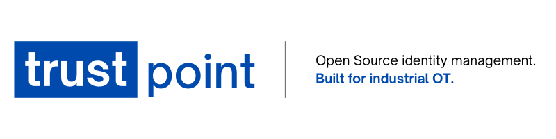

<p align="center">
  
</p>

# CRA Readiness & Reference Mapping


<p>
  <strong>EU Cyber Resilience Act Technical Reference Mapping</strong><br>
  <em>Voluntary mapping of Trustpoint security features and project artefacts to the EU Cyber Resilience Act</em>
</p>

<p>
  <a href="#"></a>
  <a href="#"></a>
  <a href="#"></a>
  <a href="#"></a>
</p>

---


> ### CRA Informational Notice
>Trustpoint is free and open-source software provided under the MIT License. The repository's MIT license alone does not determine CRA applicability or the legal role of any distributor, maintainer, or integrator.
>
> This CRA documentation is provided for informational purposes only. It does not constitute an EU Declaration of Conformity, a formal conformity assessment, certification, or legal advice.
>
> The information may support users, integrators, and downstream manufacturers in their own CRA assessments. Responsibility for determining CRA applicability, classification, conformity assessment requirements, and regulatory obligations remains with the respective economic operator placing a product with digital elements on the EU market.


## **Purpose Statement**

**Trustpoint** is an open-source trust anchor software designed to solve the critical challenge of digital identity management in industrial and OT environments. It manages PKI and certificate lifecycle operations. This document indexes related technical artefacts and their verification limits.

This informational mapping relates repository artefacts to topics in Regulation (EU) 2024/2847. It does not determine that Trustpoint meets the Regulation, that all controls are effective, or that the release is ready.

The assessment is based on the following maintained artefacts:

* [`THREAT_MODEL.md`](./THREAT_MODEL.md) — identified threats to Trustpoint assets and components
* [`RISK_REGISTER.md`](./RISK_REGISTER.md) — evaluated cybersecurity risks and residual risk decisions
* [`CONTROLS.md`](./CONTROLS.md) — implemented, in-progress, and planned security controls
* [`SECURITY.md`][security] — vulnerability disclosure and security contact process

---

## **Purpose & Scope**

This technical reference mapping identifies material potentially relevant to Article 31 and Annex VII technical documentation obligations, Article 13 cybersecurity risk assessment obligations, Article 32 conformity assessment preparation, and Annex I essential cybersecurity requirements.

**Scope:** Trustpoint server software, web application, API, CA/RA logic, enrollment services, certificate lifecycle management, key handling, database, configuration, monitoring, and release process.

**Product Context:** Trustpoint manages digital identities, certificates, and trust relationships for industrial devices, with EST, CMP, SCEP, Trustpoint-specific REST enrollment and OPC UA GDS Push paths subject to policy and implementation limits. AOKI remains a proof of concept; see [capabilities and limitations](../features/capabilities.md).

**Out of Scope:** Physical host security, customer-specific network security, third-party PKI operation, relying-party device security, and customer-specific operating procedures.

---

## Release Evidence Reviewed on 2026-10-30

This review checked the local source at `82f85c3cf32547e2684ccbe47a51390bcb62782b`
and the repository's `RELEASE_READINESS_1.0.0.md`. It did not inspect current hosted
CI runs, registry attestations or a published 1.0.0 release. That report separates
original audit findings, subsequent fixes and unexecuted acceptance checks; its
historical test results are not a new test run for every later commit.

| Item | Repository evidence | Verification limit |
| --- | --- | --- |
| Software version | `pyproject.toml`, the `trustpoint` entry in `uv.lock`, `docs/source/conf.py` and root `CHANGELOG.md` identify **1.0.0**, the first stable version | This establishes declared metadata, not publication or a signed release tag |
| Compatibility baseline | [Deployment](../features/management/docker_deployment.rst) and changelog specify a fresh installation | No development-database upgrade compatibility is claimed |
| Supported versions / support period | Root `SECURITY.md` specifies reporting and acknowledgement commitments | It has no supported-version table or defined support duration; these remain open |
| Architecture / risk artefacts | 26 threat entries, 9 risk entries and 25 control entries are present | Counts establish inventory, not completeness, effectiveness or approval |
| Local verification | Release-readiness report records revision-specific tests, lint, typing, docs and isolated deployment probes | Known audit findings and unexecuted operational/HSM/authenticated checks remain; passing tools do not establish conformity |
| Release artefacts | Publishing workflows configure image provenance attestations; SBOM workflow generates CycloneDX and SPDX | Exact release image, SBOM, digest and attestation correspondence has not been verified here |
| Recovery objectives | RTO 1–4 hours and RPO 15–60 minutes are recorded below as planning targets | No measured recovery exercise establishes these timings |

**Status legend:** ✅ means an artefact or documented mechanism is present, not
that a legal requirement or security outcome has been met. 🔄 and “Partial” mean
implementation or release evidence remains incomplete. “Not established” is not
an exemption. External badges and workflow links are pointers, not retained
version-specific evidence or conformity decisions.

## **Risk Management and Evidence Process**

The repository documents the following intended security risk and evidence process; this review does not establish that every step has been completed for 1.0.0.

```text
Threat Model → Risk Register → Controls → Evidence → Review
```

| Step | Document | Purpose |
| ---- | -------- | ------- |
| 1. Threat Model | [`THREAT_MODEL.md`](./THREAT_MODEL.md) | Identifies threats to Trustpoint assets and affected components |
| 2. Risk Register | [`RISK_REGISTER.md`](./RISK_REGISTER.md) | Groups threats into cybersecurity risks, evaluates inherent and residual risk |
| 3. Controls | [`CONTROLS.md`](./CONTROLS.md) | Documents implemented, in-progress, and planned controls |
| 4. Evidence | [`CRA_COMPLIANCE.md`](./CRA_COMPLIANCE.md) - ![Current document][badge-you-are-here] · [`SECURITY.md`][security] · CI/CD artifacts · SBOM | Provides evidence for implemented controls, vulnerability handling, release processes, and security maintenance |
| 5. Review | [`THREAT_MODEL.md`](./THREAT_MODEL.md) · [`RISK_REGISTER.md`](./RISK_REGISTER.md) · [`CONTROLS.md`](./CONTROLS.md) · [`CRA_COMPLIANCE.md`](./CRA_COMPLIANCE.md) | Defines review topics; completed reviews and resulting decisions require separate evidence |

---

{id="project-identification"}
## 1️⃣ **Project Identification**

*Reference topics: CRA Article 31 and Annex VII § 1 - Product Description Requirements, including intended purpose and software versions affecting compliance.*

| Field | Value |
| ----- | ----- |
| Product | Trustpoint Trust Anchor Software |
| Declared software version | 1.0.0 — first stable baseline; publication not verified by this review |
| Repository | https://github.com/Trustpoint-Project/trustpoint |
| Security Contact | trustpoint@campus-schwarzwald.de |
| Purpose (1-2 lines) | Open-source trust anchor software for managing digital identities, PKI infrastructure, and certificate lifecycle operations in industrial and OT environments |
| Distribution model | MIT-licensed open source; commercial activity and legal roles require separate assessment |

### Market Category: [](#project-identification)

### Confidentiality Level: [](#project-identification)

**Justification:** Trustpoint manages cryptographic keys, certificates, device identity data, trust anchors, configuration, and operational records. Confidentiality protection is required for private key material, secrets, credentials, configuration data, and security-relevant operational information.

### Integrity Level: [](#project-identification)

**Justification:** Trustpoint acts as a trust anchor and PKI management platform. Unauthorized changes to certificate policies, trust anchors, issuance workflows, revocation information, configuration, or release artifacts could compromise all dependent systems and devices.

### Availability Level: [](#project-identification)

**Justification:** Certificate issuance, renewal, revocation, and onboarding processes must remain available to prevent disruption of industrial communication and device lifecycle operations.

| Attribute | Level | Justification |
| --------- | ----- | ------------- |
| **Confidentiality** | [![High][badge-cia-high]](#project-identification) | Protects cryptographic keys, secrets, credentials, identity data, and security-relevant configuration |
| **Integrity** | [![Critical][badge-cia-critical]](#project-identification) | Trust anchor function; integrity compromise could affect dependent industrial systems |
| **Availability** | [![High][badge-cia-high]](#project-identification) | Certificate lifecycle operations are required for secure industrial operation |

---

{id="cra-scope--classification"}

## 2️⃣ **CRA Scope & Reference Classification**

*References CRA Article 2 - Scope, Article 7 - Important Products with Digital Elements, Article 8 - Critical Products with Digital Elements, Article 32 - Conformity Assessment Procedures, and Annex III / Annex IV.*

### Current Distribution: [](#cra-scope--classification)

### License: [](#cra-scope--classification)

### CRA Reference Classification: [](#cra-scope--classification)

**Scope:** Trustpoint is free and open-source software distributed under the MIT License through public repositories such as GitHub and Docker Hub. This review has not assessed commercial arrangements or economic-operator roles.

Under the CRA, free and open-source software is generally within scope for manufacturer obligations when it is made available on the market in the course of a commercial activity. Publication or hosting in a public software repository does not by itself constitute such commercial activity.

**Reference Classification:**

- Trustpoint's core functionality includes public key infrastructure (PKI), certificate issuance, CA/RA functionality, certificate lifecycle management, and machine identity management.
- This functionality corresponds to **CRA Annex III, Class I, point 9: "Public key infrastructure and digital certificate issuance software."**
- This functional reference is not a complete applicability or classification decision for a particular distribution or combined product; Annex IV applicability must also be considered by the responsible operator.
- The Annex III Class I designation in this document is therefore a **functional reference classification** and does not constitute a formal legal classification or conformity assessment of Trustpoint.
- If Trustpoint is placed on the EU market in the course of a commercial activity, the responsible economic operator must determine the applicable CRA obligations and conformity assessment procedure.
- Where free and open-source software falling under Annex III is commercially placed on the market by a manufacturer, CRA Article 32(5) provides specific conformity assessment provisions, subject to the conditions defined in the Regulation.

Organizations incorporating Trustpoint into their own products remain responsible for determining the CRA applicability and classification of the resulting product.


---

## 3️⃣ **Technical Documentation**

*BSI TR-03183-1 is a structuring reference only. This review did not verify a selected edition or assess conformity to that technical guideline.*

This section indexes material against the topics of CRA Article 31 and Annex VII; it does not establish that the technical documentation is legally complete. The detailed risk analysis remains in [`THREAT_MODEL.md`](./THREAT_MODEL.md), [`RISK_REGISTER.md`](./RISK_REGISTER.md), and [`CONTROLS.md`](./CONTROLS.md). This document acts as the technical evidence index and records whether the required artefacts are available, linked, and reviewable.


### CRA Annex VII Content Reference Index

| CRA Annex VII Item | Evidence status | Repository evidence / gap |
| --- | --- | --- |
| **1(a) Product description and intended purpose** | Documented | Section 1, [README][readme] and architecture documentation describe intended use; this is not validation of every product claim |
| **1(b) Software versions affecting compliance** | Partial | Declared 1.0.0 metadata agrees across package, lockfile and docs. The exact distributed image, source revision, tag and corresponding evidence still need to be bound together |
| **1(c) Hardware photographs / layout** | Outside this software-only scope | Any combined hardware product needs its own assessment |
| **1(d) User information from Annex II** | Partial | Operational instructions exist; complete Annex II coverage, support period and decommissioning evidence have not been established |
| **2(a) Design and development / architecture** | Documented; completeness not established | Architecture, threat model and implementation sources exist; see the release-readiness report for limits and unresolved findings |
| **2(b) Vulnerability handling, SBOM and updates** | Partial | Disclosure policy and workflows exist. A release-specific SBOM, support policy and verified update/advisory process are not established by their presence |
| **2(c) Production, monitoring and validation** | Partial | CI/build/provenance workflows are configured; configuration is not proof of successful execution for the release |
| **3 Risk assessment and Annex I applicability** | Needs reconciliation | Risk/control catalogue exists but its portfolio totals conflict with the individual entries, and the release audit records security findings requiring disposition |
| **4 Support-period determination** | Not established | `SECURITY.md` has no support duration or rationale. Recovery targets do not establish a support period |
| **5 Standards / technical specifications** | Not established | References are listed, but selected editions, applicability and any resulting assessment have not been verified |
| **6 Test reports for Annex I requirements** | Partial | Local technical checks are recorded in the release review; they do not constitute tests proving legal conformity or cover every requirement |
| **7 EU Declaration of Conformity** | Not provided | This mapping is not a declaration. Applicable obligations require a separate determination; absence is not recorded as an exemption |
| **8 SBOM for surveillance requests** | Workflow present; release evidence unverified | CycloneDX/SPDX generation is configured. Review the actual release SBOM and define retention/access/response procedures where applicable |

### BSI TR-03183-1 Documentation Baseline

| TR-03183-1 Area | Status | Trustpoint Documentation / Implementation | Evidence |
| --------------- | ------ | ----------------------------------------- | -------- |
| **Assessment scope** | ✅ | Scope covers Trustpoint server software, web application, API, CA/RA logic, enrollment services, certificate lifecycle management, key handling, database, configuration, monitoring, and release process. Out-of-scope items are explicitly listed. | This document · [`THREAT_MODEL.md`](./THREAT_MODEL.md) |
| **Product description and intended purpose** | ✅ | Trustpoint is documented as an open-source trust anchor and certificate lifecycle management platform for industrial and OT environments. Intended functionality includes digital identity management, PKI operation, CA/RA workflows, enrollment, renewal, revocation, and trust anchor management. | Section 1 · [README][readme] · [ReadTheDocs][readthedocs] |
| **Reasonably foreseeable use and misuse** | ✅ / 🔄 | Foreseeable OT deployment conditions and misuse cases are reflected in the threat model, including weak/default credentials, exposed administrative interfaces, Brownfield onboarding ambiguity, delayed updates in segmented or air-gapped environments, and misconfiguration due to limited PKI expertise. | [`THREAT_MODEL.md`](./THREAT_MODEL.md) · TM-TP-002 · TM-TP-015 · TM-TP-021 · TM-TP-025 · TM-TP-026 |
| **System / component boundaries** | ✅ | Product components are identified and used consistently across the risk chain: web application, API layer, authentication and authorization, CA/RA logic, policy/profile management, enrollment services, lifecycle management, key and secret management, database, audit logging, deployment, monitoring, CI/CD, and external PKI / relying-party integrations. | [`THREAT_MODEL.md`](./THREAT_MODEL.md) · Component Overview C-01-C-14 |
| **Asset identification** | ✅ | Security-relevant assets are identified before risk evaluation, including CA private keys, RA credentials, trust anchors, certificate profiles, device identity data, issued certificates, revocation data, administrative accounts, configuration/secrets, database contents, audit logs, backups, dependencies, source code, release artifacts, and documentation. | [`THREAT_MODEL.md`](./THREAT_MODEL.md) · Asset Overview A-01-A-15 |
| **Threat modelling** | ✅ | Threat identification uses STRIDE plus PKI, web/API, supply-chain, OT deployment, and foreseeable misuse context. The current baseline contains 26 identified threats mapped to assets and components. | [`THREAT_MODEL.md`](./THREAT_MODEL.md) · Section 4 of this document |
| **Risk identification and grouping** | ✅ | Threats are grouped into 9 cybersecurity risks with traceability from each risk to related `TM-TP-xxx` threats. | [`RISK_REGISTER.md`](./RISK_REGISTER.md) · Risk, Threat, and Control Traceability |
| **Risk estimation** | ✅ | Each risk records likelihood, confidentiality/integrity/availability impact, and inherent risk level. The likelihood model and C/I/A impact model are documented in the risk register. | [`RISK_REGISTER.md`](./RISK_REGISTER.md) · Methodology · Active Risks |
| **Risk evaluation** | 🔄 | Individual catalogue entries record six Low and three Medium residuals, while the register summary shows the reverse. These are unrevalidated catalogue labels, not a current release-risk determination. | [`RISK_REGISTER.md`](./RISK_REGISTER.md) · Risk Summary · Section 4 of this document |
| **Risk treatment decision** | ✅ / 🔄 | Risks are treated through implemented, in-progress, and planned controls. Treatment labels exist, but current maintainer acceptance and reconciliation with the release audit are not established by this review. | [`RISK_REGISTER.md`](./RISK_REGISTER.md) · [`CONTROLS.md`](./CONTROLS.md) |
| **Control selection and mapping** | ✅ / 🔄 | 25 controls are documented and mapped to the 9 risks. Controls cover authentication, authorization, auditability, session handling, key protection, cryptographic defaults, certificate lifecycle, device identity verification, revocation, deployment configuration, TLS, secret management, backup/recovery, monitoring, sensitive-data logging, dependency management, CI, review, SBOM, release integrity, vulnerability disclosure, triage, security updates, and supported versions. | [`CONTROLS.md`](./CONTROLS.md) · Control-to-Risk Mapping · Section 6 of this document |
| **Implementation evidence** | ✅ / 🔄 | Evidence is linked through project documentation, source repository artefacts, CI/CD workflows, SBOM portal, GitHub Security Advisories, release notes, Docker Hub, and maintained security documentation. | [`SECURITY.md`][security] · [SBOMs][sbom-portal] · [GitHub Actions][actions] · [Releases][releases] · [Docker Hub][dockerhub] |
| **Vulnerability handling evidence** | ✅ / 🔄 | Vulnerability reporting is private via GitHub Security Advisories. `SECURITY.md` commits to acknowledgement within five business days and describes handling expectations. Response history and execution of that process were not verified. | [`SECURITY.md`][security] · C-TP-022 · C-TP-023 · C-TP-024 · C-TP-025 |
| **Review and maintenance** | ✅ | A quarterly workflow creates review reminders. Completed reviews and resulting approvals were not verified for this release. | This document · [`THREAT_MODEL.md`](./THREAT_MODEL.md) · [`RISK_REGISTER.md`](./RISK_REGISTER.md) · [`CONTROLS.md`](./CONTROLS.md) |


### Security Improvement Roadmap

The following items should remain visible in the technical documentation until they are completed or formally accepted:

* Verify the configured image provenance attestations against the actual release digest and source revision; configured generation alone is insufficient.
* Mature the vulnerability handling process, including supported-version communication and security update workflow.
* Expand protocol security evidence for the implemented EST/CMP/SCEP/REST and OPC UA GDS Push paths. Keep AOKI labelled as a proof of concept.
* Validate backup, recovery, and monitoring evidence against the stated RTO/RPO targets.

---

## 4️⃣ **Threat and Risk Assessment**

*Reference topics: CRA Article 13(2)-(4), Article 31, Annex VII § 3, and Annex I risk-based essential cybersecurity requirements.*

- **Threat catalogue:** [`THREAT_MODEL.md`](./THREAT_MODEL.md)
- **Risk catalogue:** [`RISK_REGISTER.md`](./RISK_REGISTER.md)
- **Control catalogue:** [`CONTROLS.md`](./CONTROLS.md)

### Threat Baseline

| Threat Area | Count | Primary CRA Relevance |
| ----------- | ----: | --------------------- |
| Identity and access | 3 | Access control, secure by default, authorization |
| Key and cryptography | 3 | Cryptographic security, key protection, secure configuration |
| Certificate lifecycle | 5 | Secure issuance, renewal, revocation, identity binding |
| Enrollment and onboarding | 4 | Device identity verification, replay/tamper resistance, foreseeable misuse |
| Data, logs, and backups | 3 | Confidentiality, integrity, recovery, auditability |
| Deployment and configuration | 3 | Secure deployment, TLS, administrative interface exposure |
| Supply chain and release | 3 | Dependency security, CI/CD, artifact integrity, SBOM |
| OT-specific operation | 2 | Segmented environments, air-gapped operation, operator usability |
| **Total Threats** | **26** | **Input to risk evaluation and control selection** |

### Risk Portfolio

| Per-risk catalogue entries | Recorded count |
| --- | ---: |
| Total risks | 9 |
| Critical | 0 |
| High | 0 |
| Medium | 3 |
| Low | 6 |

These counts follow the nine individual entries, not the conflicting summary in
`RISK_REGISTER.md` (which lists six Medium and three Low). The register's summary,
targets and risk decisions need maintainer reconciliation. They have not been
changed or approved by this technical evidence review.

**Current release-risk determination:** not established by this catalogue. The
root `RELEASE_READINESS_1.0.0.md` records unresolved security findings. Recording
no High/Critical catalogue entries does not show that the release has no such
risks, or that residual risk has been accepted.

### Risk, Threat, and Control Traceability

| Risk ID | Risk Category | Related Threats | Main Controls | Recorded residual (unrevalidated) |
| ------- | ------------- | --------------- | ------------- | -------- |
| **R-TP-001** | Supply Chain Attack | TM-TP-022 · TM-TP-023 · TM-TP-024 | C-TP-017 · C-TP-018 · C-TP-019 · C-TP-020 · C-TP-021 | **L** |
| **R-TP-002** | Unauthorized Access | TM-TP-001 · TM-TP-002 · TM-TP-003 · TM-TP-021 | C-TP-001 · C-TP-002 · C-TP-003 · C-TP-004 · C-TP-011 · C-TP-012 | **L** |
| **R-TP-003** | Private Key Compromise | TM-TP-004 · TM-TP-005 | C-TP-005 · C-TP-006 · C-TP-013 · C-TP-014 | **L** |
| **R-TP-004** | Certificate Forgery | TM-TP-006 · TM-TP-007 · TM-TP-008 · TM-TP-012 · TM-TP-013 · TM-TP-014 | C-TP-005 · C-TP-006 · C-TP-007 · C-TP-008 · C-TP-009 · C-TP-010 | **L** |
| **R-TP-005** | Component Vulnerabilities | TM-TP-022 | C-TP-017 · C-TP-018 · C-TP-019 · C-TP-022 · C-TP-023 · C-TP-024 | **L** |
| **R-TP-006** | Protocol Weaknesses | TM-TP-013 · TM-TP-014 · TM-TP-020 | C-TP-006 · C-TP-007 · C-TP-009 · C-TP-012 | **M** |
| **R-TP-007** | Data Breach | TM-TP-016 · TM-TP-017 · TM-TP-018 · TM-TP-024 | C-TP-003 · C-TP-004 · C-TP-011 · C-TP-012 · C-TP-013 · C-TP-015 · C-TP-016 | **L** |
| **R-TP-008** | Service Disruption | TM-TP-009 · TM-TP-010 · TM-TP-018 · TM-TP-025 · TM-TP-026 | C-TP-008 · C-TP-010 · C-TP-014 · C-TP-015 · C-TP-024 · C-TP-025 | **M** |
| **R-TP-009** | Incomplete Vulnerability Handling | TM-TP-022 · TM-TP-023 · TM-TP-024 | C-TP-020 · C-TP-022 · C-TP-023 · C-TP-024 · C-TP-025 | **M** |

### Risk Treatment Summary

**Recorded Low (not revalidated):** R-TP-001, R-TP-002, R-TP-003, R-TP-004, R-TP-005, R-TP-007

**Recorded Medium (acceptance not verified):**

* **R-TP-006 — Protocol Weaknesses:** Ongoing protocol security reviews, TLS/mTLS guidance, and protocol tests
* **R-TP-008 — Service Disruption:** Continued improvement of backup/recovery, monitoring, deployment guidance, and operational resilience
* **R-TP-009 — Incomplete Vulnerability Handling:** Ongoing improvement of vulnerability triage, supported-version communication, release notes and security update communication.

---

## 5️⃣ **Essential Cybersecurity Requirements**

*Reference topics: CRA Article 6, Article 13(1)-(4), and Annex I Parts I and II.*

| CRA Requirement | Status | Implementation / Evidence | Related Risks |
| --------------- | ------ | ------------------------- | ------------- |
| **Annex I Part I (1): appropriate level of cybersecurity based on risks** | ✅ / 🔄 | Threat model, risk register, control catalogue, secure architecture boundaries, and residual-risk review. | R-TP-002 · R-TP-004 · R-TP-006 · R-TP-007 · R-TP-008 |
| **Annex I Part I (2)(a): no known exploitable vulnerabilities when made available** | 🔄 | Dependency monitoring, security advisories, maintainer review, release readiness checks; unresolved release-audit findings prevent treating scans alone as proof of this outcome. | R-TP-001 · R-TP-005 · R-TP-009 |
| **Annex I Part I (2)(b): secure by default configuration** | ✅ / 🔄 | Authentication required, secure cryptographic defaults, TLS guidance, production settings, debug-disabled production guidance. | R-TP-002 · R-TP-006 · R-TP-007 |
| **Annex I Part I (2)(c): vulnerabilities addressable through security updates** | ✅ / 🔄 | Versioned releases, Docker images, release notes, update workflow; automatic security update expectations are not currently claimed and should be documented for the product model. | R-TP-005 · R-TP-008 · R-TP-009 |
| **Annex I Part I (2)(d): protection from unauthorised access** | ✅ / 🔄 | Django authentication, session handling, API authentication, RBAC, permission checks, audit logs. | R-TP-002 · R-TP-004 · R-TP-007 |
| **Annex I Part I (2)(e)-(g): confidentiality, integrity, and data minimisation** | ✅ / 🔄 | Software/PKCS#11 envelope encryption and secret fields exist; key recovery, provider-specific mechanisms and deployment boundaries still require the release checks recorded in the audit. | R-TP-003 · R-TP-007 · R-TP-008 |
| **Annex I Part I (2)(h)-(i): availability, resilience, and limited negative impact on other services** | 🔄 | Backup and recovery, monitoring and metrics, Docker deployment, RTO/RPO targets; recovery/resilience acceptance evidence and measured timing remain open. | R-TP-008 |
| **Annex I Part I (2)(j)-(k): reduced attack surface and incident-impact limitation** | ✅ / 🔄 | Deployment guidance, administrative interface guidance, TLS/mTLS, secure configuration, review and hardening activities. | R-TP-002 · R-TP-006 · R-TP-007 |
| **Annex I Part I (2)(l): security-related logging and monitoring** | ✅ / 🔄 | Administrative/lifecycle logs and metrics exist; placeholder health/vulnerability commands were removed and do not provide assessment coverage. | R-TP-002 · R-TP-007 · R-TP-008 |
| **Annex I Part I (2)(m): secure removal of data and settings** | 🔄 | Needs explicit user guidance and, where applicable, implementation evidence for secure decommissioning and data removal. | R-TP-007 · R-TP-008 |
| **Annex I Part II (1): identify and document vulnerabilities and components, including SBOM** | ✅ / 🔄 | CycloneDX/SPDX generation is configured; the actual release SBOM, current findings and component coverage were not verified. | R-TP-001 · R-TP-005 · R-TP-009 |
| **Annex I Part II (2)-(4): remediate vulnerabilities, test/review security, disclose fixed vulnerabilities** | ✅ / 🔄 | Dependabot, CI, tests, maintainer review, release notes; a verified fixed-vulnerability disclosure/advisory record is not established by this review. | R-TP-005 · R-TP-009 |
| **Annex I Part II (5)-(6): coordinated vulnerability disclosure and reporting contact** | ✅ / 🔄 | Private-reporting instructions, security contact, acknowledgement commitment and requested report contents are documented; actual handling records were not inspected. | R-TP-009 |
| **Annex I Part II (7)-(8): secure update distribution and free security updates with advisory messages** | ✅ / 🔄 | Versioned releases and Docker images are available; secure update distribution, supported-version policy, and advisory-message workflow remain open process/verification requirements. | R-TP-001 · R-TP-008 · R-TP-009 |
| **Annex II user information and instructions** | ✅ / 🔄 | Documentation describes deployment, operations, security configuration and integrations; complete Annex II coverage has not been established; formal support period, vulnerability contact prominence, and secure decommissioning procedures remain open requirements for the 1.0.0 evidence set. | [Architecture Documentation][arch-docs] · [ReadTheDocs][readthedocs] · [`SECURITY.md`][security] · R-TP-006 · R-TP-008 · R-TP-009 |

**Status:** `PARTIAL_TECHNICAL_EVIDENCE_MAPPING` — artefacts are linked, but control effectiveness, residual-risk acceptance and legal conformity are not established. The release audit and unexecuted acceptance checks remain relevant.

**Security reporting policy:** private via GitHub Security Advisories, acknowledgement commitment of five business days, and public recognition unless anonymity is requested. This describes the policy, not measured handling performance.

**Contact:** trustpoint@campus-schwarzwald.de

---

## 6️⃣ **Technical Evidence and Verification Limits**

*Reference topics: CRA Article 31 - Technical Documentation, Article 32 - Conformity Assessment Procedures, and Annex VIII - Conformity Assessment Procedures.*

### Control Evidence Summary

| Control Area | Controls | Status | Evidence Examples |
| ------------ | -------: | ------ | ----------------- |
| Access control | 4 | ✅ / 🔄 | Django auth configuration, source code, authorization tests, audit logs, deployment documentation |
| Cryptographic security | 2 | ✅ / 🔄 | PKCS#11 integration, HSM configuration, crypto tests, certificate profile code |
| Certificate lifecycle security | 4 | 🔄 | CA/RA implementation, lifecycle workflows, revocation implementation, protocol tests, documentation |
| Secure deployment | 4 | ✅ / 🔄 | Docker configuration, deployment documentation, TLS guidance, backup configuration, recovery documentation |
| Logging and monitoring | 2 | ✅ / 🔄 | Audit log implementation, application logs, monitoring and metrics configuration |
| Supply chain security | 5 | ✅ / 🔄 | `uv.lock`, security workflows, source review, SBOM/provenance generation configuration |
| Vulnerability handling | 4 | ✅ / 🔄 | [`SECURITY.md`][security], GitHub Security Advisories, documented handling process and release notes; defined support policy remains missing |
| **Total Controls** | **25** | **Catalogue inventory; effectiveness not established** | **Control catalogue maintained in [`CONTROLS.md`](./CONTROLS.md)** |

### Quality & Security Automation Status

| Area | Repository mechanism | Evidence limit |
| --- | --- | --- |
| Unit tests / coverage | Pytest and coverage workflows select `trustpoint/ tests/`; coverage/JUnit artifacts are retained | No numeric coverage threshold is enforced; badge percentages and the final release run were not verified here |
| Type checking | Locked project mypy environment, shared by hooks and CI | Checks the configured source scope, not a claim of complete type coverage |
| Code quality | Repository-wide Ruff lint; staged/PR-changed Python formatting | Untouched formatting debt and project exclusions remain |
| Dependency review | Lockfile, CodeQL and license workflows; earlier point-in-time advisory results in the release audit | No Dependabot update configuration was found in this checkout; hosted security-alert settings and current dependency findings were not verified |
| OpenSSF | Linked project badge and project page | A badge is not a standards certificate; its current status was not inspected |
| SBOM | Syft workflow generates CycloneDX and SPDX from a built image | The final 1.0.0 image/digest/SBOM correspondence was not verified |
| CI/CD / deployment | Build, test and deployment workflows are present | Workflow existence does not establish passing current runs or closed release findings |
| ZAP | Operational setup precondition, required reports and failure/finding policy are configured | Hosted execution and authenticated protected-path coverage remain unverified |
| Release integrity | `publish-ghcr.yml` and `docker-manual.yml` configure `actions/attest-build-provenance` | Attestations are not merely planned, but the published release attestation and subject digest still need verification |
| Vulnerability handling / support | Private disclosure policy and acknowledgement commitment exist | Case handling history, supported versions, support duration and complete advisory/update evidence remain open |

**Badges:**

[![OpenSSF][badge-openssf]][openssf]
[![Pytest][badge-pytest]][pytest]
[![codecov][badge-codecov]][codecov]
[![MyPy][badge-mypy]][mypy]
[![Ruff][badge-ruff]][ruff]
[![License: MIT][badge-license]][license]

**Evidence status:** source artefacts and local verification are available, with
limits recorded above and in the root release-readiness review. Hosted workflow
results, badges, final release SBOM/attestations and formal risk acceptance were
not revalidated here. None of these tables constitutes conformity evidence on
its own.

---

## 7️⃣ **Security Maintenance and Vulnerability Handling**

*Reference topics: CRA Article 13(6)-(11), Article 13(17)-(23), Article 14 reporting obligations, and Annex I Part II vulnerability handling requirements.*

| Area | Documented mechanism | Verification limit |
| --- | --- | --- |
| Vulnerability monitoring | CI/security workflows, dependency lockfile and linked advisory services | Hosted service configuration, current alerts and continuous operation not verified |
| Vulnerability intake | Private GitHub reporting and security contact in `SECURITY.md` | Five-business-day acknowledgement is a policy commitment, not measured response evidence |
| Triage and updates | Policy, source changes, tests, release notes and publishing workflows | End-to-end handling of an actual report and affected-version communication not verified |
| Regulatory incident reporting | Applicability and responsible operator need separate determination | GitHub advisory tracking does not establish fulfilment of Article 14 reporting obligations |
| Posture monitoring | Linked OpenSSF/CI badges and security services | Current badge status and release-specific evidence not verified |
| Distribution | Configured GitHub/registry publication routes | Exact final release version, digest and provenance need verification |
| Review cycle | Quarterly reminder workflow and documented update triggers | Creating an issue does not establish a completed review or maintainer approval |

**Monitoring Resources:** [GitHub Security][security] · [CI/CD Status][actions] · [OpenSSF][openssf]

---

## 8️⃣ **EU Declaration of Conformity**

*Reference topics: CRA Article 28 - EU Declaration of Conformity*

Organisations that incorporate Trustpoint into a product with digital elements and place that product on the EU market may have obligations under the Cyber Resilience Act.

Trustpoint provides publicly available technical and security information—including architecture documentation, threat/control catalogues, vulnerability-management policy, local test records and SBOM-generation workflows—that may support a downstream manufacturer's conformity assessment.

---


## 9️⃣ Reference Mapping Status

This document provides a voluntary CRA reference mapping based on the security, architecture, development, and operational evidence available within the Trustpoint project.

**Status:** `INFORMATIONAL_REFERENCE_MAPPING`

The mapping may support users, integrators, and downstream manufacturers in their own CRA assessments. It does not constitute:

- a formal conformity assessment,
- an EU Declaration of Conformity,
- CE marking,
- certification, or
- legal advice.

Trustpoint is provided as free and open-source software under the MIT License. This mapping does not declare release readiness or replace the technical release checklist. Applicable legal obligations and any required assessment must be determined independently; the informational label does not waive them.

Organizations incorporating Trustpoint into products placed on the EU market remain responsible for determining their own CRA applicability, classification, conformity assessment requirements, and regulatory obligations.

> **Note:** The availability of CRA-related documentation or technical evidence does not by itself establish CRA conformity of Trustpoint or of any product incorporating Trustpoint.


---

## **CRA Assessment Maintenance**

### Security Review Update Triggers

1. Security architecture changes, including authentication methods, enrollment protocols, CA/RA logic, or cryptographic configuration
2. Changes affecting essential cybersecurity requirements
3. Major dependencies with security implications
4. Risk profile changes, including new threats or changed residual risk ratings
5. New or substantially changed controls
6. Regulatory or standards updates affecting PKI, certificate lifecycle management, or vulnerability handling
7. Major version releases
8. Security incidents or vulnerability disclosures requiring reassessment

**Review principle:** review updates for security impact and record the decision. Calling an update routine does not by itself establish whether further technical or regulatory assessment is required.

---

## **Related Documents**

**Project:** [ReadTheDocs][readthedocs] · [SECURITY.md][security] · [LICENSE][license] · [CONTRIBUTING.md][contributing] · [AUTHORS.md][authors]

**CRA Evidence Chain:** [`THREAT_MODEL.md`](./THREAT_MODEL.md) · [`RISK_REGISTER.md`](./RISK_REGISTER.md) · [`CONTROLS.md`](./CONTROLS.md) · [`CRA_COMPLIANCE.md`](./CRA_COMPLIANCE.md)

**Standards:** RFC 7030 (EST) · RFC 9483 (CMP) · OPC UA GDS Push v1.05 · Django Security · OWASP ASVS · BSI TR-03183-1

**Regulatory:** [EU CRA][cra-regulation] · Article 13 (Manufacturer obligations) · Article 31 / Annex VII (Technical documentation) · Article 32 / Annex VIII (Conformity assessment) · Annex I (Essential cybersecurity requirements) · Annex V (EU Declaration of Conformity)

**Security:** [OpenSSF][openssf] · [GitHub Security][security] · [CI/CD][actions] · [Coverage][codecov]

---

<!-- Reference Links -->
[cra-regulation]: https://eur-lex.europa.eu/eli/reg/2024/2847/oj
[readthedocs]: https://trustpoint.readthedocs.io
[arch-docs]: https://trustpoint.readthedocs.io/en/latest/development/architecture/index.html
[sbom-portal]: https://trustpoint-project.github.io/trustpoint/
[dockerhub]: https://hub.docker.com/r/trustpointproject/trustpoint
[releases]: https://github.com/Trustpoint-Project/trustpoint/releases
[dependabot]: https://github.com/Trustpoint-Project/trustpoint/security/dependabot
[security]: https://github.com/Trustpoint-Project/trustpoint/blob/main/SECURITY.md
[readme]: https://github.com/Trustpoint-Project/trustpoint/blob/main/README.md
[authors]: https://github.com/Trustpoint-Project/trustpoint/blob/main/AUTHORS.md
[actions]: https://github.com/Trustpoint-Project/trustpoint/actions
[pytest]: https://github.com/Trustpoint-Project/trustpoint/actions/workflows/pytest.yml
[mypy]: https://github.com/Trustpoint-Project/trustpoint/actions/workflows/mypy.yml
[ruff]: https://github.com/Trustpoint-Project/trustpoint/actions/workflows/ruff.yml
[codecov]: https://codecov.io/gh/Trustpoint-Project/trustpoint
[contributing]: https://github.com/Trustpoint-Project/trustpoint/blob/main/CONTRIBUTING.md
[openssf]: https://www.bestpractices.dev/projects/11535
[docker-builds]: https://github.com/Trustpoint-Project/trustpoint/actions/workflows/docker-manual.yml
[license]: https://opensource.org/licenses/MIT

<!-- Badges -->
[badge-cia-high]: https://img.shields.io/badge/High-blue?style=flat-square
[badge-cia-critical]: https://img.shields.io/badge/Critical-red?style=flat-square
[badge-rto]: https://img.shields.io/badge/Target_1--4hrs_unverified-yellow?style=flat-square
[badge-rpo]: https://img.shields.io/badge/Target_15--60min_unverified-yellow?style=flat-square
[badge-community]: https://img.shields.io/badge/Community-green?style=flat-square&logo=users&logoColor=white
[badge-standard]: https://img.shields.io/badge/Standard-green?style=flat-square&logo=clipboard-check&logoColor=white
[badge-you-are-here]: https://img.shields.io/badge/You%20are%20here-blue?style=flat-square
[badge-openssf]: https://www.bestpractices.dev/projects/11535/badge
[badge-pytest]: https://github.com/Trustpoint-Project/trustpoint/actions/workflows/pytest.yml/badge.svg?branch=main
[badge-codecov]: https://codecov.io/gh/Trustpoint-Project/trustpoint/graph/badge.svg?token=0N31L1QWPE
[badge-mypy]: https://github.com/Trustpoint-Project/trustpoint/actions/workflows/mypy.yml/badge.svg?branch=main
[badge-ruff]: https://github.com/Trustpoint-Project/trustpoint/actions/workflows/ruff.yml/badge.svg?branch=main
[badge-license]: https://img.shields.io/badge/License-MIT-yellow.svg
