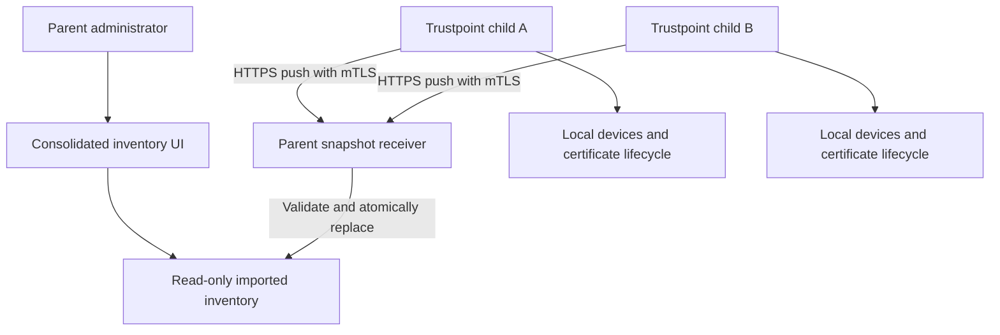
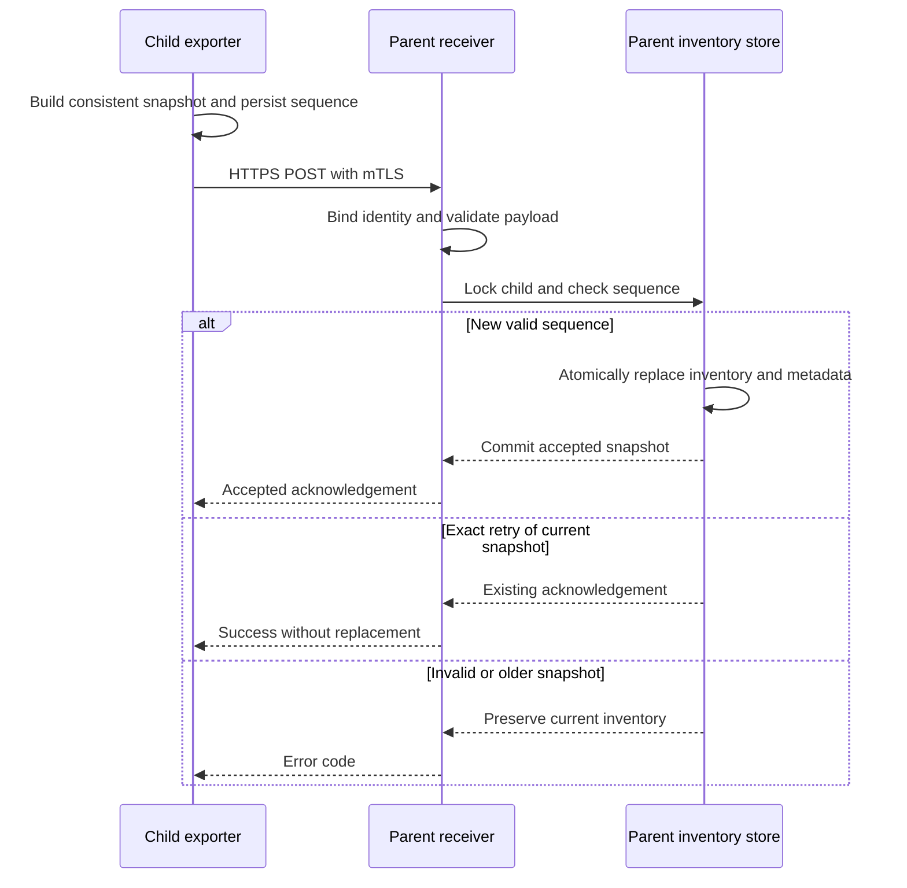

# Trustpoint Cascaded Instances: MVP Concept

Date: 2026-10-13  
Status: Concept based on agreed MVP decisions; no implementation performed.

## 1. Purpose

Enable an administrator to oversee devices and certificate inventories from several Trustpoint instances through one parent Trustpoint instance. Typical deployments include a company overview of several production sites, or a site overview of several machine-level instances.

Each child remains autonomous and authoritative for its own devices, certificate lifecycle, trust configuration, and policies. The parent stores a read-only projection of child inventories. Loss of connectivity to the parent must not block local certificate operations.

The cascade is a management relationship. It does not imply a shared root CA, subordinate CAs, shared domains, or a common certificate issuance path.

## 2. Agreed MVP Scope

| Area | Decision |
| --- | --- |
| Topology | One parent with multiple direct children |
| Parent function | Read-only inventory aggregation |
| Local authority | Issuance, renewal, revocation, policies, and device operations remain local |
| Communication | Child-initiated HTTPS push |
| Authentication | mTLS with manual child registration |
| Isolation | Each connection identity can update only its registered child's inventory |
| Payload | Device and certificate metadata, including domain/profile references |
| Synchronization | Complete snapshots; configurable five-minute default interval |
| Consistency | Atomic inventory replacement; stale updates cannot overwrite newer ones |
| Identity | Registered child ID plus local record ID |
| Parent permissions | Parent administrators only |
| Secrets | No operational private keys, device credentials, or enrollment secrets are exported |

The parent may continue managing its own local inventory. Imported child records must remain separate from local operational records and must never become inputs to local enrollment or renewal jobs.

## 3. Architecture and Boundaries



Children push only their own local inventory. Forwarding imported inventories is excluded from the MVP. A child has one configured parent, and registration of the parent as its own child is rejected. Longer cascades, multiple parents, and cycle detection across instances remain future work.

Suggested implementation components are an exporter and scheduled sender on the child, and a registry, authenticated receiver, imported inventory models, and administrator views on the parent. Names and endpoints below are proposals, not claims about existing repository functionality. Repository inspection is required before implementation to select existing scheduling, authentication, model, and UI conventions.

## 4. Registration and Connection Identity

1. The parent administrator creates a child registration with a display name and an optional site label. The parent assigns an opaque UUID as the aggregation child ID.
2. A dedicated client connection key is generated and retained on the child. Its certificate is provisioned manually using an agreed administrative process.
3. The parent administrator registers the certificate fingerprint and appropriate client trust configuration against that child ID.
4. The child administrator configures the parent HTTPS endpoint, assigned child ID, client certificate/key, and parent server trust anchors.
5. A test push verifies identity binding and reports the result on both instances.

The parent validates the client certificate's chain, validity, and client-authentication usage, then checks the explicitly allowed certificate fingerprint. A valid certificate from a trusted CA alone does not authorize a child. The authenticated registration determines the inventory scope; a child ID supplied in a URL or payload cannot override it.

The child validates the parent server certificate and hostname. Disabling TLS verification is not supported. Connection trust and operational certificate trust must have separate configuration and authorization purposes, even when an organization chooses to provision both through the same PKI.

Manual certificate rotation should allow the administrator to authorize a replacement fingerprint before switching the child, then remove the old fingerprint. Disabling a registration immediately denies further imports. Automatic enrollment and renewal of connection certificates are outside MVP scope; certificate expiry must be visible to administrators.

If mTLS terminates at a reverse proxy, only that trusted proxy may supply authenticated client identity to the application. The backend must be inaccessible through a bypass route, and incoming client-supplied identity headers must be stripped. The deployment's existing TLS stack must be inspected before choosing direct or proxy termination.

## 5. Data Model

| Proposed entity | Main fields and responsibility |
| --- | --- |
| `AggregationChild` | Assigned UUID, display name, site label, enabled flag, allowed certificate fingerprints, last accepted sequence, last successful receipt, last error |
| `AggregationExportConfig` | Child-side parent endpoint, assigned child UUID, TLS credential reference, server trust configuration, interval, persistent sequence counter |
| `AggregationSnapshot` | Child reference, schema version, sequence, snapshot UUID, generation time, receipt time, canonical payload hash, record counts |
| `AggregatedDevice` | Child reference, local device ID, name, local domain/profile references, optional locally reported operational status |
| `AggregatedCertificate` | Child reference, local certificate ID, optional local device ID, profile reference, issuer label, serial number, certificate fingerprint, validity, locally reported lifecycle status |

Imported records must be uniquely scoped by `(child_id, local_record_id)`. Device names, domain names, serial numbers, and certificate fingerprints are not global record identifiers. An identical certificate appearing on two children remains two source records in the MVP; consolidated totals count source records rather than globally unique certificates.

Use opaque strings for local IDs to avoid coupling the protocol to database primary-key types. Use a defined serial-number encoding, such as hexadecimal strings, and UTC timestamps. Include a SHA-256 certificate fingerprint as certificate identity metadata. Do not export certificate PEM/DER content by default.

Domain/profile references are descriptive references to child configuration, not locally executable parent objects. A certificate without a device association may still be included; if a device reference is present, it must resolve within that snapshot. Define the complete inventory scope explicitly during repository mapping, including whether CA certificates belong in it, so dashboard totals are unambiguous.

Certificate expiry is calculated from validity timestamps at display time. Revocation or other lifecycle status is explicitly labeled as reported by the child at the last snapshot, rather than independently verified by the parent. Optional operational alerts must be bounded, structured metadata; omit raw exception messages that may contain secrets.

## 6. Proposed Snapshot API

Proposed endpoint:

```http
POST /api/aggregation/v1/snapshots/
Content-Type: application/json
```

The receiver accepts only an authenticated, enabled child's complete inventory. An illustrative payload follows; UUIDs and values are examples.

```json
{
  "schema_version": 1,
  "child_id": "d462b752-76a4-4f41-a261-483746d41038",
  "snapshot_id": "14f30b02-8d72-4b04-aa0d-1fa4c4c634ae",
  "sequence": 42,
  "generated_at": "2026-10-13T07:35:00Z",
  "devices": [
    {
      "local_id": "device-17",
      "name": "Production switch 17",
      "domain_ref": "production",
      "profile_refs": ["tls_server"]
    }
  ],
  "certificates": [
    {
      "local_id": "certificate-81",
      "device_local_id": "device-17",
      "profile_ref": "tls_server",
      "issuer_label": "Site A Issuing CA",
      "serial_hex": "01AF",
      "fingerprint_sha256": "aaaaaaaaaaaaaaaaaaaaaaaaaaaaaaaaaaaaaaaaaaaaaaaaaaaaaaaaaaaaaaaa",
      "not_before": "2026-10-01T00:00:00Z",
      "not_after": "2027-10-01T00:00:00Z",
      "reported_status": "issued"
    }
  ]
}
```

| Result | Proposed behavior |
| --- | --- |
| New accepted snapshot | `200`; return snapshot ID, sequence, and receipt timestamp |
| Retry of the current accepted snapshot | `200`; return the original acknowledgement without replacing data or advancing freshness |
| Malformed or inconsistent snapshot | `400`; preserve the previous inventory |
| TLS identity invalid | Reject at the TLS boundary |
| Unregistered, disabled, or mismatched child | `403`; no inventory change |
| Older sequence or conflicting reuse of a sequence | `409`; no inventory change |
| Payload exceeds configured limit | `413`; no partial import |
| Unsupported schema version | `400` with a stable version error code |
| Rate limit or temporary failure | `429` or `5xx`; child retries with backoff |

Use stable machine-readable error codes and sanitized descriptions. Enforce finite request-size, record-count, string-length, and rate limits. Concrete limits should be set from representative inventories before the first pilot; pagination is not required for the MVP.

## 7. Snapshot Consistency and Ordering

The child builds a complete, internally consistent snapshot using database snapshot semantics or equivalent locking appropriate to the existing storage stack. An export failure must never be represented as an empty inventory. A successfully generated empty inventory is valid and removes previously imported records for that child.

Persist a monotonically increasing sequence counter on the child. Assign it when generating a new snapshot, and reuse the same sequence, snapshot ID, and payload for a retry. The parent compares sequences, not child timestamps, for ordering.

Validation checks schema, field types, duplicate local IDs, certificate time ranges, and device references before replacement. Under a transaction and per-child concurrency lock, recheck the sequence, replace all imported records for that child, and update snapshot metadata together. Any failure rolls back the entire import. Readers see one accepted inventory version, never a partially replaced mix.

A canonical payload hash detects conflicting reuse of an accepted sequence. A retry matching the current accepted snapshot is idempotent. Any sequence lower than the current accepted sequence is rejected, even if it once represented an accepted snapshot.

Sequence allocation and sending are serialized per child. If a backup restore resets the counter, synchronization fails visibly until an administrator deliberately re-registers the child or reconciles the sequence. Automatic resets are excluded because they would weaken ordering protection.



Retain the current accepted snapshot and bounded synchronization event metadata. Historical inventory versions and a central audit-log mirror are outside scope.

## 8. Scheduling, Failure Handling, and Freshness

The default synchronization interval is five minutes and is configurable on the child. Introduce scheduling jitter to avoid simultaneous pushes from many children. Use one in-flight send per child, bounded connection/request timeouts, and exponential backoff with jitter for transient failures.

After a lost acknowledgement, retry the identical snapshot. Do not accumulate an unbounded queue during an outage: once an attempt is resolved or abandoned, generate a new complete snapshot of current local state. Old inventory history does not need replaying.

Authentication, schema, and size failures surface as actionable errors and use a slow retry schedule instead of rapid repeated requests. Local export/sender health is visible on the child. The parent can report errors it observes but cannot know why an unreachable child has stopped sending.

Proposed freshness defaults, to be confirmed during the pilot:

| State | Meaning |
| --- | --- |
| Never synchronized | Registered, but no valid snapshot has been accepted |
| Fresh | A new snapshot was accepted within three expected synchronization intervals |
| Stale | No new accepted snapshot within that threshold; retain and visibly label last-known data |
| Disabled | Administrator disabled imports; retain last-known data with a disabled label |

Communicate the configured expected interval to the parent through registration settings; changes must update both sides. Freshness uses the parent's receipt time for a newly accepted snapshot. Show the child's generation time separately and flag materially delayed snapshots or clock skew. Identical retries do not refresh inventory age.

Stale does not prove that a child is offline or that its certificate operations failed. Dashboard totals must distinguish current data from stale or disabled sources. Do not automatically delete inventory when a connection is lost.

## 9. Parent Administrator Experience

Provide an overview of child names, site labels, freshness, last receipt, device/certificate counts, and connection-certificate expiry. Provide certificate filters for source child, device, domain/profile, expiration, and reported lifecycle status.

Use a configurable expiration warning window, with a proposed initial default of 30 days. Distinguish expired certificates from revoked certificates and distinguish certificate condition from inventory freshness. A stale source's apparently valid certificate cannot be presented as newly verified.

Show source child and local record ID on detail pages. Provide navigation to the child's UI only when an administrator has configured an appropriate base URL. Opening a link does not provide shared login or parent authority over the child.

Registration settings, manual rotation, disable/re-enable, and inventory removal require parent administrator permissions. Inventory removal is a separate explicit action; disabling imports retains the last-known data. Parent views and APIs must not expose issuance, renewal, revocation, or device-operation actions for imported records.

## 10. Assumptions and Parked Risks

Assumptions: children have periodic outbound access to the parent; metadata sharing is approved by the participating sites; administrators can provision connection credentials; initial inventories fit within bounded full-snapshot requests; local IDs remain stable; the existing application stack can support transactional imports and a periodic sender.

| Parked item | Future decision or risk |
| --- | --- |
| Multi-level cascading | Origin identity, loop prevention, duplicate paths, and propagated freshness |
| Central control | Command authorization, local approval, idempotency, audit, and outage behavior |
| Large inventories | Incremental updates, pagination, compression, and performance targets |
| Air-gapped sites | Explicit offline export/import format and authenticity verification |
| Connection automation | Enrollment, renewal, revocation checking, and trust-anchor rotation |
| Fine-grained visibility | Site-specific access, delegated administration, and metadata redaction |
| Historical reporting | Retention policy, storage cost, and versioned inventory queries |
| Compromised child | mTLS establishes source identity, not truthfulness of reported inventory |
| Compromised parent | Consolidated metadata is sensitive and needs normal backup/access protections |
| Backup and cloning | Identity duplication and sequence rollback require deliberate recovery |

## 11. Implementation Slices and Acceptance Criteria

1. Inspect the current repository and map device/certificate records, administrator permissions, API routing, TLS termination, and background scheduling. Finalize inventory scope and finite resource limits.
2. Implement registration, connection identity binding, snapshot validation, and atomic parent imports. Verify with synthetic inventories before wiring the exporter.
3. Implement consistent child export, persistent sequencing, scheduling, and failure reporting. Connect two children to one parent.
4. Add the administrator overview, search/filtering, freshness labels, and registration operations. Validate the complete pilot, including an outage and recovery.

The MVP is complete when the following behaviors are demonstrated:

- Two children with identical local record IDs remain isolated and appear correctly in one overview.
- A child cannot write another child's records, and unregistered or disabled identities cannot import.
- A successful full snapshot reflects additions, changes, and removals; a valid empty snapshot clears only that child's inventory.
- Malformed input, unresolved device references, excessive payloads, or database failure preserve the previous accepted inventory.
- Concurrent sends and out-of-order delivery cannot replace a newer snapshot with an older one.
- Retrying after a lost acknowledgement is idempotent and does not advance inventory freshness.
- Parent downtime leaves local issuance, renewal, and revocation operational; recovery synchronizes the latest complete inventory.
- Stale inventories remain visible with their source and timestamps, and are distinguishable in totals.
- Certificate rotation and registration disablement behave as configured without affecting local operational keys.
- Non-administrators cannot access aggregation data or registration settings.
- Exported payloads contain no private keys, device credentials, enrollment secrets, or raw certificate content.

Recommended next action: implement the registration and snapshot receiver as the first vertical slice, then validate with one parent and two child instances. No implementation or deployment is authorized by this document alone.

## 12. Source and Design Basis

The attached document, `trustpoint_11_deutscher_it_sicherheitspreis.pdf`, pages 3–4, describes local CA/RA operation, domain-based management, certificate lifecycle handling, and use in segmented or air-gapped OT environments. This concept preserves those deployment principles; it does not claim that the described aggregation functionality already exists.

MVP scope decisions were agreed in the accompanying lean-grill discussion on 2026-10-13. Endpoint names, model names, freshness thresholds, and warning windows in this document are proposed implementation defaults. Actual repository compatibility and performance have not yet been verified.
