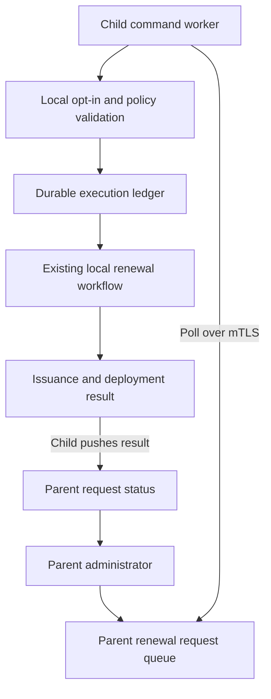
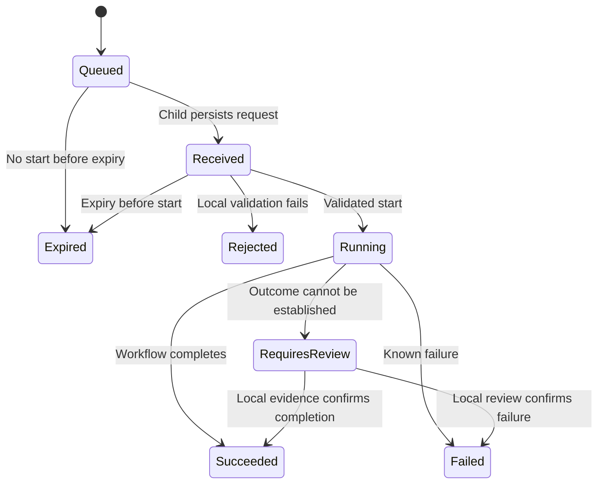
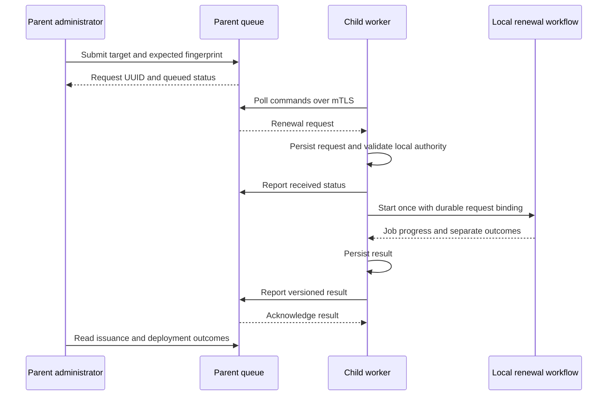

# Trustpoint Cascaded Instances: MVP 2 — Remote Renewal

Date: 2026-10-13  
Status: Confirmed MVP scope; technical design proposal; no implementation performed.  
Prerequisite: MVP 1, `trustpoint_cascaded_instances_concept.md`.

## 1. Purpose and Relationship to MVP 1

MVP 1 consolidates device and certificate metadata from autonomous child Trustpoint instances into a parent. MVP 2 adds one central action: a parent administrator can request renewal of a selected certificate through its responsible child.

The child remains authoritative for permissions, policy, issuance, and device operations. The parent communicates intent and displays results; the child executes its existing supported renewal workflow. Private keys, enrollment credentials, and device credentials remain local.

The existing one-parent/multiple-direct-children topology, manual registration, mTLS identity binding, administrator access, and five-minute full inventory snapshots remain in place. Remote commands use a separate polling and result channel; inventory snapshots are not command acknowledgements.

## 2. Confirmed Scope

| Area | MVP 2 decision |
| --- | --- |
| Action | Renew one selected certificate through an existing child workflow |
| Local authorization | Remote renewal disabled by default; explicitly enabled by a child administrator |
| Execution | Automatic after local policy and target validation |
| Delivery | Child-initiated polling over mTLS; configurable one-minute default |
| Expiry | Configurable one-hour default; checked before execution |
| Target binding | Child ID, local certificate/assignment references, and expected certificate fingerprint |
| Stale target | Reject if the selected certificate has already been replaced |
| Result | Report issuance and deployment separately |
| Retry safety | Unique request ID and durable child execution tracking |
| Uncertain execution | Reconcile with the local job; otherwise require review and block further remote renewal for that target |
| Access | Parent administrators submit requests; local administrators control opt-in and resolve uncertain outcomes |

Central issuance, revocation, bulk renewal, policy distribution, scheduled execution, and new device integrations are outside scope. No per-request child approval is required after opt-in. A child advertises only workflows it can actually execute.

## 3. Architecture



The parent needs no inbound connection to an OT child. A child reuses the dedicated mTLS connection identity from MVP 1. The parent binds every poll and status submission to the authenticated child registration; a payload cannot select another child's scope.

Proposed components are a parent request queue and administrator action, a child polling worker and durable ledger, a local workflow adapter, and a parent result view. All model names and routes below are proposals. Inspect the repository before implementation to identify actual renewal services, job tracking, permissions, and scheduling conventions.

## 4. Local Capabilities and Opt-In

Add a child-side `remote_renewal_enabled` setting, defaulting to false. Only a local administrator can change it; the parent cannot turn it on remotely. Disabling it prevents new starts but does not attempt to stop a running workflow.

Publish capability metadata through a versioned extension of the existing snapshot contract:

- Whether remote renewal is enabled.
- Which targets have a supported renewal workflow.
- Whether that workflow performs certificate issuance only or also deployment.
- A stable reason code where a target is unsupported.

Capabilities in the parent view are advisory and have the snapshot's freshness. The child rechecks capabilities and policy immediately before starting. Targets with stale inventory should show a warning to the parent administrator; local validation remains mandatory even for fresh inventory.

Opt-in permits invocation of existing workflows, including their existing deployment/restart behavior. The parent should display the known effects before submission. Per-device consent, maintenance windows, and a redesigned deployment process remain future work.

## 5. Request and Execution Data

| Proposed entity | Responsibility |
| --- | --- |
| `RemoteRenewalRequest` | Parent-side request UUID, target child, local target references, expected fingerprint, creator, creation/expiry timestamps, latest reported state |
| `RemoteRenewalExecution` | Child-side immutable request binding, payload hash, expiry, local target, execution state, local job reference, issuance/deployment outcomes, last result version |
| `RemoteRenewalEvent` | Bounded state-transition history with actor, timestamp, stable reason code, and sanitized message |

Use a stable logical renewal target, such as the local device/profile assignment or the existing credential lifecycle identity, for concurrency control. Locking only the old certificate row is insufficient because renewal can replace that row.

A request includes the selected certificate's local ID and SHA-256 fingerprint. The child resolves these to the logical assignment and rejects mismatches. Parent-supplied profile references are context, not authority to change profile or policy. Key generation, algorithm, subject, SANs, and deployment settings follow the existing local workflow. The request does not carry new key material or arbitrary enrollment parameters.

The parent records the initiating administrator. On the child this is attribution asserted by its trusted parent, not an independently authenticated local user; the authenticated execution principal is the registered parent connection.

Illustrative command payload:

```json
{
  "schema_version": 1,
  "request_id": "57f0ee26-f01e-4b83-ac04-e98c2a1f4663",
  "action": "renew_certificate",
  "child_id": "d462b752-76a4-4f41-a261-483746d41038",
  "target": {
    "certificate_local_id": "certificate-81",
    "assignment_local_id": "assignment-12",
    "expected_fingerprint_sha256": "aaaaaaaaaaaaaaaaaaaaaaaaaaaaaaaaaaaaaaaaaaaaaaaaaaaaaaaaaaaaaaaa"
  },
  "created_at": "2026-10-13T11:00:00Z",
  "expires_at": "2026-10-13T12:00:00Z",
  "initiated_by": {
    "parent_user_id": "admin-7",
    "display_name": "Parent administrator"
  }
}
```

Concrete target field mapping is an implementation prerequisite. Unsupported certificates that lack a suitable renewal target are rejected rather than assigned a new artificial workflow.

## 6. Delivery and API Contract

| Proposed route | Access and behavior |
| --- | --- |
| `POST /api/aggregation/v1/renewal-requests/` | Parent administrator creates one request; returns `202` and its UUID |
| `GET /api/aggregation/v1/renewal-requests/{request_id}/` | Parent administrator reads status, timestamps, and outcomes |
| `GET /api/aggregation/v1/commands/` | mTLS child fetches a bounded batch of its eligible requests |
| `PUT /api/aggregation/v1/commands/{request_id}/status/` | mTLS child submits a versioned execution status for its request |

Administrator routes use normal parent user authentication and applicable CSRF controls. Child routes use the dedicated mTLS identity. Authentication mechanisms cannot substitute for each other's permissions.

The parent creation endpoint accepts a caller-generated idempotency key so a retried UI submission does not create two requests. The same key with conflicting content is rejected. Duplicate active requests for the same logical target should also be rejected where the parent can resolve that identity.

Polling does not consume a command. An unacknowledged request may be delivered repeatedly until the child reports durable receipt, expiry occurs, or a terminal result arrives. The child stores a request before acknowledging it. Requests already running are not redelivered as new work, but their status can be retransmitted after connectivity recovers.

Status messages contain a monotonically increasing child-side version per request. Matching repeated versions are idempotent; conflicting versions and older updates cannot overwrite a newer state. The child retains unacknowledged results and retries with backoff. Parent receipt timestamps are separate from child event timestamps.

Use bounded payloads, finite queue sizes, batch limits, and sanitized error messages. Requests are immutable after creation. Cancellation of queued or running requests is outside MVP scope; expiry and child opt-out provide the defined pre-execution boundaries.

## 7. Validation and Start Boundary

Before starting a request, the child verifies:

1. It was fetched from the configured parent using validated server TLS and the registered connection identity.
2. Schema, action, child binding, UUID, timestamps, and field sizes are valid.
3. The request ID has not been reused with different content.
4. Remote renewal is enabled, and the request has not expired.
5. The referenced certificate still matches the expected fingerprint and is current for the resolved assignment.
6. The existing workflow supports renewal and satisfies local policy.
7. No local or remote renewal is active for that logical target and no unresolved outcome blocks it.

Validation and start coordination must use the same concurrency mechanism as local automatic/manual renewal. Recheck the current certificate and opt-in at the actual workflow start boundary, after obtaining the target lock. If the existing workflow scheduler defers execution, repeat time-sensitive checks when its worker starts.

Expiry is evaluated at the start boundary and does not interrupt a running workflow. Request timing requires sufficiently synchronized clocks. If clock health cannot establish whether a request is still valid, do not start it; report a clock-related rejection requiring correction.

Use stable rejection reasons such as `remote_renewal_disabled`, `request_expired`, `target_replaced`, `target_not_found`, `workflow_unsupported`, `local_policy_denied`, `target_busy`, and `outcome_unresolved`.

## 8. Execution States and Outcomes



The parent's `Queued` state reflects its queue; subsequent execution states come from the child. If the parent has no start confirmation after expiry, show the deadline has passed and execution is unconfirmed, rather than asserting that nothing ran. A delayed report may establish that the child started before expiry and completed later. Delivery is stopped after expiry, while result updates remain accepted for existing requests.

Report outcome dimensions separately:

| Dimension | Proposed values |
| --- | --- |
| Issuance | `not_started`, `in_progress`, `issued`, `failed`, `unknown` |
| Deployment | `not_applicable`, `not_started`, `in_progress`, `deployed`, `failed`, `unknown` |

`Succeeded` means the requested existing workflow completed its defined scope. An issuance-only workflow can succeed with deployment `not_applicable`; the UI must say “Certificate issued; deployment not included.” A deployment workflow with a known installation failure reports `Failed` even if issuance succeeded. “Deployed” uses the existing workflow's completion criterion and does not imply independent proof that the device is serving the certificate unless that workflow verifies it.

Return new certificate identifiers/fingerprint as metadata, the local job ID where available, and sanitized reason codes. No certificate private key or device credential is returned. The next inventory snapshot updates the authoritative inventory projection; until then, display the completed command result separately from the older inventory.

## 9. Retries, Restarts, and Uncertain Outcomes

Persist request identity and execution intent before invoking a side-effecting workflow. Bind the request UUID durably to its local job. Where possible, create the ledger and local job transactionally, and pass the request UUID as the local workflow's idempotency key.

Duplicate delivery returns the saved state or resumes delivery of saved results. It never blindly invokes renewal again. This design requires at-least-once message delivery with duplicate suppression; it does not claim exactly-once external issuance or device installation.

After a restart, reconcile any `Running` entry with its bound local job and known certificate/deployment records. If the existing workflow cannot prove whether a side effect occurred, mark `RequiresReview`, retain the target block, and request local administrator review. Never label a timeout alone as a definitive failure or automatically restart an ambiguous operation.

A local administrator resolves review using available evidence and records the resolution. Resolution does not automatically issue another renewal. A confirmed failure can be followed by a new parent request, using a newly verified current target. Transport retries are automatic; retries of a failed side-effecting workflow are outside scope unless already safely supported internally by that workflow.

The logical target block must survive certificate replacement and worker restart. Local renewal coordination must prevent conflicting operations while an outcome is unresolved; emergency local overrides require explicit audited resolution. Retention of request IDs or deduplication tombstones must cover the full possible redelivery window; parent delivery must never outlive that retention.

## 10. Normal Execution Flow



If the parent becomes unavailable after execution starts, the child continues its local workflow and retains result updates for later delivery. If the child is unavailable, the request stays queued until delivery or expiry. A parent timeout cannot abort a local job.

## 11. Administrator Experience and Audit

The parent certificate detail page shows a renewal action only when the child's latest capability metadata indicates support and opt-in. The confirmation view identifies the child, device/profile assignment, selected certificate, expected workflow effects, expiry, and inventory freshness.

After submission, show request UUID, initiator, creation/deadline, last child update, state, issuance outcome, deployment outcome, and any action needed. Disable repeat requests while the same target has active or unresolved execution. A stale command status must be labeled independently of inventory freshness.

The child shows its opt-in setting, received requests, execution/job references, connection failures, and review items. Record creation, validation/rejection, start, result, opt-in changes, and review resolution. Cross-instance logs share the request UUID for correlation. Parent logs retain the initiating user; child logs retain the authenticated parent identity and parent-asserted initiator separately.

## 12. Assumptions and Parked Risks

Assumptions: MVP 1 is operational; supported local renewal jobs expose enough evidence for reconciliation; local and remote renewals can share target locking; connection identities and administrator permissions are already isolated; child clocks can support deadline checks; initial volume permits bounded polling and request queues.

| Parked item | Future decision |
| --- | --- |
| Other central actions | Issuance, revocation, bulk operations, and policy changes |
| Fine-grained permissions | Per-device rights, delegated users, and per-request local approval |
| Scheduling | Maintenance windows, reservations, and recurring execution |
| Additional workflows | Deployment adapters, activation verification, and rollback |
| Recovery automation | Resolving partially completed external side effects |
| Topology expansion | Multiple parents and multi-level command routing |
| Immediate delivery | Long polling, persistent connections, and lower latency |
| Cancellation | Race-safe pre-start cancellation and workflow-specific abort semantics |
| Compromised parent | Opt-in grants remote initiation within local policy; stronger local limits may follow |
| Disaster recovery | Ledger/job restore consistency and duplicate prevention after backups |

## 13. Implementation Slices and Acceptance Criteria

1. Inspect local renewal workflows, their eligibility rules, start boundaries, target locks, job persistence, and side effects. Choose one demonstrably supported workflow for the first pilot and document its exact success criteria.
2. Implement opt-in and capabilities, parent request creation with submission idempotency, and the child command/status API.
3. Implement durable child receipt, local validation, shared target coordination, and binding to the existing workflow. Add restart reconciliation and review handling before exposing the UI action.
4. Add parent/child views and correlated audit events. Validate with one parent and two children, exercising the failure cases below.

Acceptance criteria:

- Remote renewal is disabled by default; parent actions cannot enable it.
- An opted-in child's supported workflow renews the selected current certificate and reports separate issuance/deployment results.
- Invalid mTLS identities and cross-child command/status access are rejected.
- A repeated UI submission with the same idempotency key produces one request.
- Repeated command delivery does not create another local job or certificate.
- A conflicting payload under an existing request UUID is rejected.
- Local renewal replacing the certificate before execution causes target rejection.
- Local and remote renewal attempts for the same logical target do not run concurrently.
- A request received before expiry but started afterward is rejected as expired.
- Expiry does not interrupt an already running workflow; late results are accepted without regressing state.
- Disabling remote renewal before start prevents execution; running local work continues.
- Parent outages do not interrupt local work; persisted results are delivered after recovery.
- Child restart reconciles durable jobs without blind re-execution; uncertain outcomes require review and maintain the target block.
- Deployment failure after issuance is shown as a partial outcome, without claiming device activation.
- Duplicate or out-of-order result messages cannot regress the parent view.
- Non-administrators cannot submit requests, and requests/results expose no secrets.
- Inventory remains a snapshot projection; a successful command does not fabricate a refreshed inventory.

## 14. Design Basis and Next Action

This concept builds on the confirmed MVP 1 aggregation design and the MVP 2 lean-grill decisions of 2026-10-13. Routes, model names, capability schema, state encoding, and local workflow mapping are implementation proposals, not verified repository features.

Recommended next action: inspect the existing renewal implementation and build one complete request-to-result path for one supported target, including duplicate suppression and restart reconciliation. Repository changes and deployment require a separate implementation instruction.
