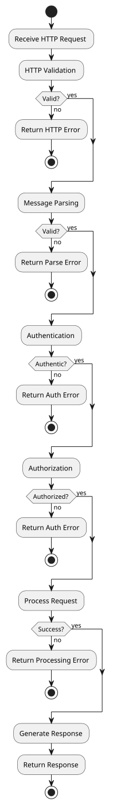
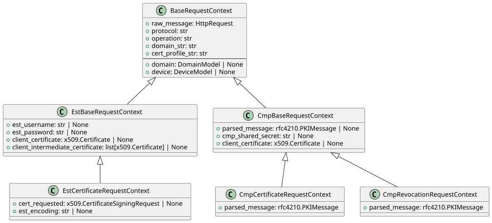
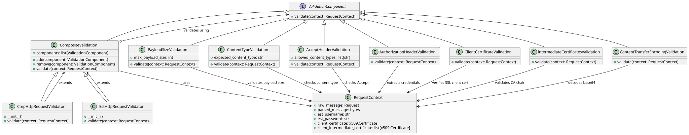
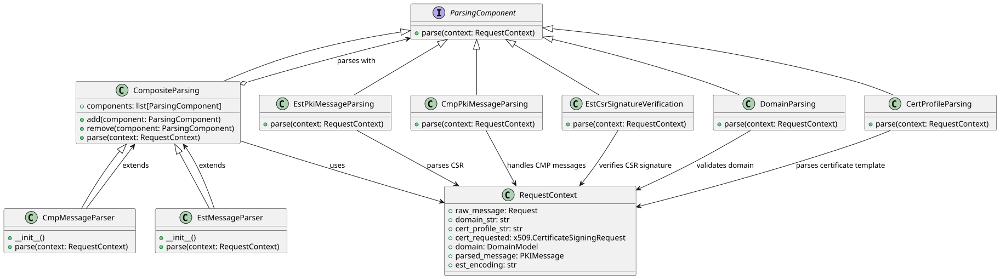
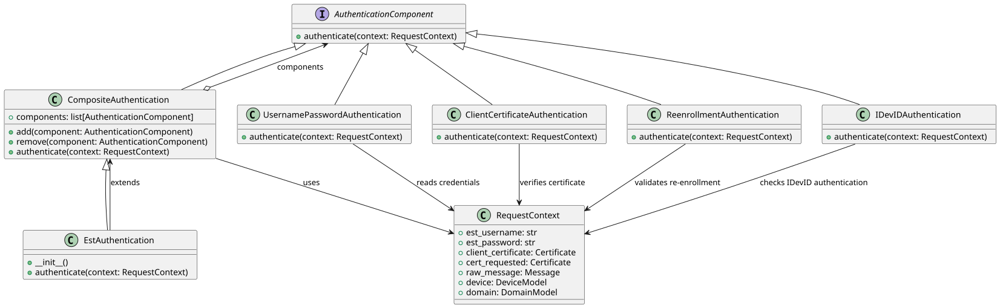
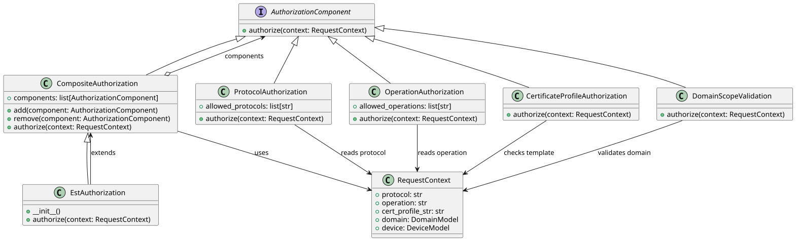

================
Request Pipeline
================

Overview
========

The request pipeline processes incoming PKI requests (EST, CMP) through a series of composable stages, each responsible for a specific aspect of request handling. The architecture uses the **Composite Pattern** throughout to allow flexible composition of validation, parsing, authentication, and authorization logic.

For a comprehensive overview of the credential architecture and component organization, see :doc:`./architecture/credentials`.

**Pipeline Stages:**

1. **HTTP Request Validation** - Validates HTTP-level attributes (headers, content-type, payload size)
2. **Message Parsing** - Parses and validates protocol-specific message content
3. **Authentication** - Verifies the authenticity of credentials presented by the client
4. **Authorization** - Determines what operations are permitted for the authenticated request
5. **Request Processing** - Processes the request to issue certificates or perform other PKI operations
6. **Response Generation** - Generates a protocol-specific response

Each stage uses the Composite Pattern with a base component interface, allowing individual components to be composed into more complex operations.

Request Pipeline Flow
=====================

The following diagram shows how requests flow through the entire pipeline:

Request Context Hierarchy
=========================

The RequestContext hierarchy carries state through the entire pipeline:

HTTP Request Validator Module Diagram
=====================================

Message Parser Module Diagram
=============================

Authentication Module Diagram
=============================

Authorization Module Diagram
============================

Key Concepts
============

**Composite Pattern**
    Each pipeline stage (validation, parsing, authentication, authorization) uses the Composite Pattern with a base component interface. This allows individual components to be composed into more complex operations, enabling flexible configuration of what rules apply to each protocol and operation.

**Request Context**
    The RequestContext object carries state through the entire pipeline. Different context types (EstCertificateRequestContext, CmpBaseRequestContext, etc.) extend BaseRequestContext to provide protocol-specific attributes while maintaining a consistent interface.

**ParsingComponent**
    Parsing components sequentially process the request context, extracting and validating message content. Examples include:

    - EstAuthorizationHeaderParsing: Extracts HTTP Basic Auth credentials
    - EstPkiMessageParsing: Parses PKCS#10 CSR
    - CmpPkiMessageParsing: Parses CMP PKIMessage
    - DomainParsing: Resolves domain identifier to DomainModel
    - CertProfileParsing: Resolves certificate profile

**AuthenticationComponent**
    Authentication components verify the authenticity of credentials. Unlike authorization, authentication does NOT determine device identity; that happens during authorization. Authentication simply validates that the provided credentials are valid.

**AuthorizationComponent**
    Authorization components determine what operations are allowed. They access the fully populated RequestContext (including domain and device information) to make authorization decisions.

**Error Handling**
    Each stage can raise exceptions with appropriate error messages. Errors are caught at the view level and converted to protocol-specific error responses (EST error messages or CMP PKIFailureInfo).