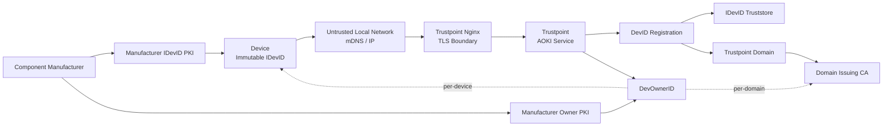
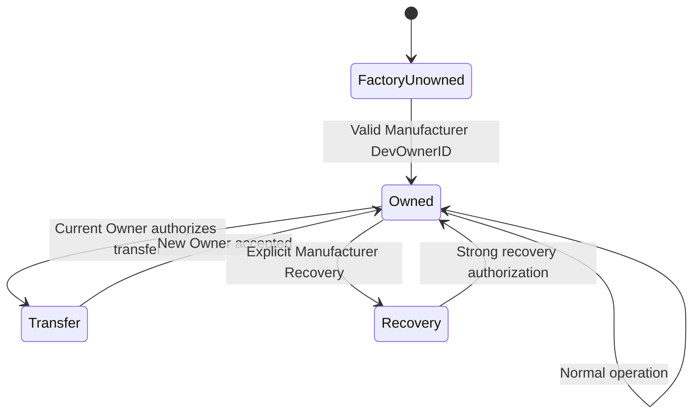
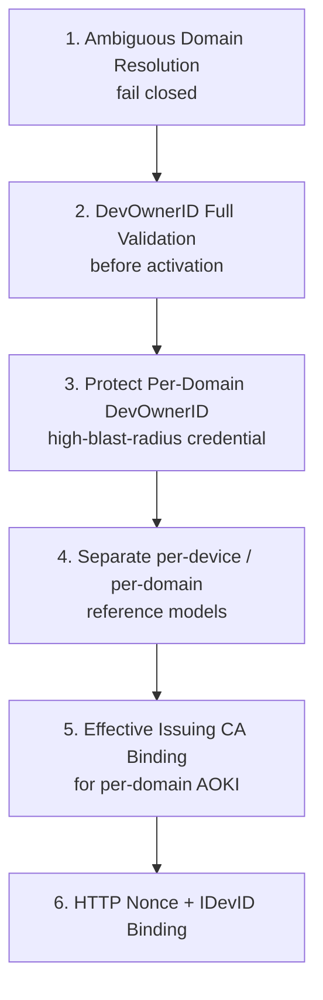

# AOKI Threat Analysis – Trustpoint

## 1. Scope

This threat analysis covers the current server-side implementation of **AOKI – Automated Onboarding Key Infrastructure** in Trustpoint.

The following components are in scope:

- Trustpoint AOKI HTTP endpoint
- Trustpoint CMP-AOKI
- IDevID authentication
- DevID Registration Patterns
- Per-device DevOwnerID
- Per-domain DevOwnerID
- Domain assignment
- Domain Issuing CAs
- CA rollover
- DevOwnerID lifecycle and selection
- Owner Credential provisioning
- Truststores
- Current Trustpoint Nginx configuration
- mDNS service discovery
- Administrative configuration
- Host, software, and supply-chain trust boundaries

The following are out of scope:

- AOKI test clients under `trustpoint/aoki/tests/`
- The concrete implementation of a production device-side AOKI client
- Physical attacks against devices
- Extraction of an IDevID private key that is assumed to be securely protected
- Full compromise of device firmware
- Full compromise of the Manufacturer PKI as a condition that AOKI itself could fully mitigate

---

# 2. Security Objectives

AOKI is intended to allow a device that has not yet been integrated into an operator PKI to identify a legitimate Owner Service and subsequently obtain a Domain Credential through established enrollment protocols such as CMP or EST.

The main security objectives are:

1. **Device Authentication**  
   Trustpoint must ensure that an eligible device possesses a valid Manufacturer IDevID.

2. **Owner Authentication**  
   The device must be able to determine that the Owner has been authorized by the Manufacturer for either the specific device or the target domain.

3. **Domain Admission Control**  
   A valid Manufacturer device must not automatically be permitted to join every Trustpoint Domain.

4. **Issuer Binding**  
   In the per-domain model, exactly the Domain Issuing CA that is actually used must be authorized.

5. **Authorization Scope Integrity**  
   The effective authorization scope of a DevOwnerID must match the intended scope. A per-device authorization must not silently expand into a domain-wide authorization.

6. **Integrity**  
   Security-relevant bootstrap information must not be modifiable without detection.

7. **Freshness / Replay Protection**  
   A previously valid AOKI response must not be reusable as a current authorization.

8. **Identity Continuity**  
   A physical device should remain uniquely associated with its immutable IDevID identity throughout its lifecycle.

9. **Credential Lifecycle Control**  
   Compromised Owner credentials must be disableable and must not remain usable indefinitely.

10. **Fail-Closed Behaviour**  
    Ambiguous or insufficiently validated states should not be implicitly accepted.

---

# 3. High-Level Trust Model



The effective authorization of a device is not determined by one credential alone.

For the current design, the actual admission scope is roughly the intersection of:

```text
Manufacturer IDevID Trust
        ∩
DevID Registration Scope
        ∩
DevOwnerID Authorization Scope
```

For a per-domain DevOwnerID, this intersection is particularly important because the DevOwnerID itself may authorize a large device population.

---

# 4. Critical Assets

## 4.1 Tier-1 Assets

### DevOwnerID Private Key

The DevOwnerID private key allows Trustpoint to authenticate itself as an authorized Owner.

The impact of compromise depends strongly on its scope.

#### Per-device DevOwnerID

The blast radius is limited to one or more explicitly referenced devices.

#### Per-domain DevOwnerID

The blast radius may cover the entire device population that can be admitted into the corresponding Trustpoint Domain.

A compromised per-domain DevOwnerID may potentially affect all devices that:

- are allowed by matching DevID Registrations,
- validate against the configured IDevID Truststore,
- are associated with the corresponding Domain,
- and trust the relevant Manufacturer Owner Trust Anchor.

Therefore:

> **A per-domain DevOwnerID private key is a domain-wide authorization credential and must be treated as a Tier-1 secret.**

---

### Manufacturer Owner Trust Anchor

Devices trust DevOwnerIDs because of their manufacturer-provisioned Owner Truststores.

The Manufacturer Owner CAs contained in these Truststores form the trust anchors for DevOwnerIDs.

Compromise of a Manufacturer Owner CA trust anchor represents a fundamental trust-anchor failure.

AOKI itself cannot fully mitigate this condition.

---

### IDevID Private Key

The IDevID represents the device's permanent identity.

For this threat model:

> The IDevID private key is assumed to be securely provisioned, sufficiently protected, and not compromised.

An IDevID compromise is not considered a normal AOKI recovery scenario.

---

### Trustpoint Domain Issuing CA

In the per-domain model, the exact SHA-256 fingerprint of the Domain Issuing CA is part of the Owner authorization.

Changing the Issuing CA therefore deliberately changes the AOKI Owner Authorization.

---

## 4.2 Tier-2 Assets

- DevID Registration Patterns
- IDevID Truststores
- OwnerCredentialModel configuration
- Trustpoint Domain configuration
- AOKI Audit Logs
- Active TLS Server Credential
- SecurityConfig
- Administrator accounts
- Trustpoint database
- Trustpoint host / container
- CI/CD pipeline and software artifacts

---

# 5. Trust Boundaries

## TB-01 — Device ↔ Local Network

The local network is considered potentially hostile.

An attacker may:

- manipulate mDNS,
- observe packets,
- block connections,
- redirect traffic,
- provide rogue services.

The attacker does not, however, possess legitimate trusted private keys unless this is explicitly part of the attack scenario.

---

## TB-02 — Nginx ↔ Django

The current Trustpoint Nginx configuration is considered part of the system under analysis.

Nginx:

- terminates TLS,
- uses `ssl_verify_client optional_no_ca`,
- extracts the client certificate actually presented during TLS,
- overwrites `SSL-Client-Cert`,
- forwards the request internally to Django.

Trustpoint subsequently validates the IDevID certificate chain itself.

The Nginx configuration is therefore considered an existing security control.

---

## TB-03 — Trustpoint ↔ Manufacturer IDevID PKI

The Manufacturer IDevID Truststore defines which device PKIs Trustpoint accepts.

Intermediate CAs supplied with the request do not automatically become trusted.

---

## TB-04 — Device ↔ Manufacturer Owner PKI

Devices contain a dedicated Owner Truststore.

The Manufacturer Owner CAs contained within this Truststore form the trust anchors for DevOwnerIDs.

A device can cryptographically establish that a DevOwnerID was issued under a trusted Manufacturer Owner PKI.

It cannot independently determine whether the Manufacturer issued that DevOwnerID to the correct business customer.

---

## TB-05 — Manufacturer ↔ Customer / Owner Authorization

The Manufacturer decides which organization receives a DevOwnerID.

This is a critical external trust boundary.

AOKI can validate:

- the certificate,
- the Manufacturer signature,
- the referenced device or Domain,
- the cryptographic proof of private-key possession.

AOKI cannot independently validate the Manufacturer's business decision that:

> "This particular customer is the legitimate owner of this device population."

This is especially important for per-domain DevOwnerIDs.

---

## TB-06 — Trustpoint Administrator ↔ AOKI Configuration

Administrators can influence security-critical AOKI configuration, including:

- Domains
- DevID Registrations
- Truststores
- Owner Credentials
- Certificate Profiles

A compromised administrator can therefore alter the trust scope.

However, an administrator without access to private keys cannot create valid Manufacturer signatures.

---

## TB-07 — Trustpoint Host / Software Supply Chain

A full host compromise may:

- expose DevOwnerID private keys,
- modify AOKI logic,
- manipulate Truststores,
- alter Audit Logs.

This scenario exists above the actual AOKI protocol trust boundary.

---

# 6. Actors

## Legitimate Actors

- Device Manufacturer
- Device
- Trustpoint Administrator
- Owner Operator
- Trustpoint Service
- Manufacturer PKI

## Threat Actors

### Local Network Attacker

Can manipulate discovery and network traffic but cannot use trusted private keys.

### Unauthorized Customer with a Valid DevOwnerID

A different customer may possess a legitimately Manufacturer-issued DevOwnerID with an authorization scope that overlaps another customer's device population.

This is particularly critical if multiple customers receive DevOwnerIDs containing the same:

```text
dev-owner:ca:<fingerprint>
```

Cryptographically, these credentials express the same domain-level authorization.

### Attacker with a Stolen DevOwnerID

An attacker may obtain the private key of a legitimate DevOwnerID through:

- credential theft,
- host compromise,
- backup compromise,
- exported PKCS#12 compromise,
- Manufacturer-side leakage,
- operational mishandling.

For a per-domain DevOwnerID, the blast radius may extend across the entire admissible device population of the Domain.

### Compromised Trustpoint Administrator

Can modify AOKI configuration but, without additional host or key compromise, cannot forge Manufacturer or DevOwnerID signatures.

### Compromised Trustpoint Host

May potentially compromise DevOwnerID keys and all Trustpoint state.

### Compromised or Misbehaving Manufacturer

May issue cryptographically valid but business-incorrect DevOwnerIDs.

This represents an external supply-chain / trust-anchor failure.

---

# 7. Key Security Assumptions

## A-AOKI-IDEVID-IMMUTABLE-01 — Immutable IDevID

The Manufacturer IDevID certificate of a device remains unchanged throughout the lifetime of the device.

It is not:

- renewed,
- rotated,
- or replaced.

Its SHA-256 fingerprint therefore represents a stable cryptographic device identifier.

---

## A-AOKI-IDEVID-COMPROMISE-01 — IDevID Compromise Requires Manufacturer Recovery

A compromised IDevID is not a normal AOKI renewal case.

The device must be handled through a separate Manufacturer / Recovery process or taken out of service.

---

## A-AOKI-PERDEVICE-DOMAIN-01 — Separation of Ownership and Domain Admission

In the per-device model, the DevOwnerID authorizes the Owner for a specific IDevID.

Admission into a Trustpoint Domain is handled separately through:

- DevID Registration Pattern
- associated IDevID Truststore

The DevOwnerID does not need to additionally contain a Domain identifier.

---

## A-AOKI-AUTH-MODE-01 — Alternative Authorization Models

Per-device and per-domain DevOwnerIDs currently represent alternative AOKI authorization models.

CMP currently evaluates:

1. per-device DevOwnerID
2. if none is found: per-domain DevOwnerID

The per-device model therefore has precedence.

---

## A-AOKI-PERDOMAIN-SCOPE-01 — Per-Domain DevOwnerID Is Domain-Wide Authorization

A valid:

```text
dev-owner:ca:<fingerprint>
```

authorizes the holder for the device population admitted under the corresponding Domain / Issuing CA scope.

The authorization is not restricted to one IDevID.

Consequently:

> Whoever controls a valid per-domain DevOwnerID private key can act as a cryptographically valid Owner for all otherwise eligible devices within that scope.

---

## A-AOKI-MANUFACTURER-01 — Manufacturer Determines Business Ownership

AOKI defines the cryptographic Owner binding.

Whether an organization is actually the business owner of a particular device or device population remains Manufacturer policy.

The Manufacturer decides:

- who receives the DevOwnerID,
- for which devices,
- for which Domain,
- and under which business-verification process.

AOKI cannot distinguish two different customers if the Manufacturer gives both cryptographically equivalent authorization.

---

## A-AOKI-DISCOVERY-01 — Discovery Is Non-Authoritative

mDNS is used exclusively for service discovery.

An endpoint discovered through `_aoki._tcp` receives no trust as a result of discovery.

Authentication and authorization must be performed completely within the subsequent AOKI protocol.

---

## A-AOKI-TIME-01 — Trustworthy Time

Participating systems require sufficiently trustworthy time for certificate-validity checks.

AOKI itself does not provide a trusted time source.

---

# 8. Existing Security Controls

## C-AOKI-IDEVID-CHAIN-01 — IDevID Path Validation

An IDevID is validated against an explicitly configured Truststore with Intended Usage `IDevID`.

Intermediate CAs supplied with the request are only used for certificate-path construction.

They do not become trust anchors.

---

## C-AOKI-IDEVID-REG-01 — Registration-Based Domain Admission

A valid Manufacturer IDevID alone is insufficient.

A corresponding `DevIdRegistration` must also match the device.

This creates three distinct layers:

```text
Manufacturer IDevID PKI
        +
DevID Registration
        +
DevOwnerID
```

For a per-domain DevOwnerID, the effective attack surface is therefore bounded by the intersection of these layers.

---

## C-AOKI-OWNER-REF-01 — Exact DevOwnerID Reference Matching

Trustpoint uses exact reference matching when resolving a DevOwnerID.

Supported references include:

```text
dev-owner:cert:<serial>_<fingerprint>

dev-owner:uri:<manufacturer-uri>

dev-owner:ca:<issuing-ca-fingerprint>
```

There is no wildcard or prefix-based authorization.

---

## C-AOKI-HTTP-SIG-01 — Signed HTTP Bootstrap Payload

The HTTP AOKI response is signed as the exact `resp.content` byte sequence using the DevOwnerID private key.

The signature therefore protects:

- AOKI version
- Enrollment information
- EST URL
- Owner ID Certificate
- TLS trust information

---

## C-AOKI-PROXY-NGINX-01 — Trusted TLS Termination

The provided Nginx configuration:

- terminates TLS,
- extracts client certificates from the actual TLS connection,
- overwrites forwarded client-certificate headers,
- thereby protects the TLS client-certificate boundary.

---

## C-AOKI-DOMAIN-SCOPE-01 — Domain Scope Validation

Within the CMP request framework, Trustpoint verifies that the authenticated device's Domain matches the requested Domain.

---

## C-AOKI-PROFILE-01 — Certificate Profile Authorization

A device may only use Certificate Profiles allowed by its Domain.

---

## C-AOKI-DOMAIN-CREDENTIAL-01 — Domain Credential Before Application Credentials

Devices using an onboarding configuration must obtain a valid Domain Credential before additional Application Credentials may be issued.

---

## C-AOKI-DOMAIN-DISABLED-ISSUE-01 — Disabled Domains Block Issuance

Although a disabled Domain can still be resolved during earlier AOKI steps, certificate issuance is prevented when:

```text
domain.is_active == False
```

---

# 9. Confirmed Threats and Security Gaps

## T-AOKI-PERDOMAIN-CRED-01 — Compromise or Misuse of a Per-Domain DevOwnerID

### Description

A per-domain DevOwnerID authorizes an Owner by binding the credential to a Trustpoint Domain Issuing CA:

```text
dev-owner:ca:<SHA256 fingerprint of Domain Issuing CA>
```

Unlike a per-device DevOwnerID, this authorization is not restricted to one specific IDevID.

Possession of the corresponding private key therefore represents broad authorization for the device population admitted into that Domain.

### Attack Scenarios

#### Scenario A — Stolen Per-Domain DevOwnerID

An attacker steals the private key of a legitimate per-domain DevOwnerID.

Possible sources include:

- Trustpoint host compromise,
- credential-store compromise,
- stolen PKCS#12 file,
- insecure backup,
- operational leakage,
- Manufacturer-generated private key retained or leaked.

The attacker can then act as a cryptographically valid Owner.

```text
Stolen per-domain DevOwnerID
        |
        v
dev-owner:ca:<Domain-CA>
        |
        +--> eligible Device A
        +--> eligible Device B
        +--> eligible Device C
        +--> ...
```

#### Scenario B — Another Customer Receives Equivalent Authorization

A Manufacturer issues another customer a DevOwnerID containing the same:

```text
dev-owner:ca:<fingerprint>
```

From an AOKI cryptographic perspective, both customers are equally authorized for the same Domain Issuing CA.

A device cannot determine which customer is the legitimate business owner.

#### Scenario C — Manufacturer Provisioning Error

The Manufacturer mistakenly authorizes the wrong customer for a Domain CA.

The resulting DevOwnerID is still cryptographically valid.

AOKI therefore accepts the authorization as issued.

### Important Limitation

The per-domain DevOwnerID does not independently bypass device eligibility checks.

Trustpoint still requires:

- valid IDevID authentication,
- validation against the configured IDevID Truststore,
- a matching DevID Registration,
- Domain admission.

Therefore, the attacker cannot create arbitrary devices solely through possession of the DevOwnerID.

However, the attacker can impersonate the Owner towards any device that is otherwise eligible within the Domain scope.

### Effective Blast Radius

The effective blast radius is:

```text
Per-domain DevOwnerID Scope
        ∩
DevID Registration Scope
        ∩
IDevID Truststore Scope
```

This blast radius may still contain a large device population.

### Impact

Potential consequences include:

- unauthorized Owner impersonation,
- unauthorized onboarding of eligible devices,
- redirection towards attacker-controlled onboarding infrastructure,
- takeover of not-yet-owned devices,
- compromise of subsequent trust establishment,
- domain-wide or fleet-wide impact.

### Classification

**High**

This is not merely an implementation bug.

It is an inherent security consequence of using a broad per-domain authorization credential.

### Existing Controls

- IDevID authentication
- IDevID Truststore
- DevID Registration
- exact `dev-owner:ca:` matching

These reduce the eligible device population but do not protect against compromise or duplicate issuance of the correct domain credential.

### Proposed Mitigations

#### 1. Strong Key Protection

Per-domain DevOwnerID private keys should preferably be protected using:

- HSM
- TPM
- PKCS#11
- another non-exportable hardware-backed key mechanism

Software key storage may remain supported, but the higher residual risk must be explicit.

#### 2. Prefer Owner-Generated Keys

Preferred provisioning flow:

```text
Trustpoint generates private key
        |
        v
CSR
        |
        v
Manufacturer signs
        |
        v
DevOwnerID returned
```

The Manufacturer never receives the private key.

#### 3. Explicit Lifecycle State

Introduce:

```text
ACTIVE
DISABLED
COMPROMISED
```

Only `ACTIVE` credentials may be used.

#### 4. Duplicate Domain Authorization Detection

Multiple DevOwnerIDs containing the same:

```text
dev-owner:ca:<fingerprint>
```

should be visible and auditable.

Duplicate authorization should be intentional, not accidental.

#### 5. Manufacturer Issuance Controls

The Manufacturer should verify that:

- the requester is authorized for the corresponding device population,
- the supplied CA fingerprint belongs to the intended customer,
- duplicate authorization is intentional,
- issuance events are audited.

#### 6. Persistent Ownership State

After a device has accepted an Owner, a later valid per-domain DevOwnerID should not automatically replace that existing ownership relationship.

This is addressed further by `T-AOKI-OWN-01`.

### Residual Risk

If a valid per-domain DevOwnerID private key is stolen before ownership has been established, AOKI cannot distinguish the attacker from the legitimate Owner.

Recovery then requires external mechanisms such as:

- disabling the compromised DevOwnerID,
- Manufacturer intervention,
- replacement credential issuance,
- explicit ownership recovery.

---

## T-AOKI-HTTP-REPLAY-01 — Replay of AOKI HTTP Initialization Response

### Current Implementation

The HTTP AOKI endpoint:

- uses GET,
- currently has no request nonce,
- has no challenge,
- has no freshness binding,
- does not explicitly bind the response to the requesting IDevID fingerprint,
- does not explicitly set `Cache-Control: no-store`.

### Attack Scenario

```text
Device requests /aoki/init
        |
        v
valid signed response
        |
attacker records response
        |
        v
response replayed later
```

If a DevOwnerID contains multiple valid device references, the issue may potentially extend across multiple devices within the same authorization scope.

### Impact

- Replay of stale enrollment information
- Use of outdated TLS trust information
- Reuse of old Owner authorization
- Cross-device replay within a multi-reference DevOwnerID scope

### Proposed Mitigation

Device-generated nonce:

- CSPRNG
- at least 128 bits of entropy
- new for every transaction
- included in request
- returned unchanged inside signed response
- accepted for exactly one open transaction
- invalidated after use

Additionally include:

```text
idevid-sha256 = <fingerprint>
```

inside the signed response.

Defense in depth:

```http
Cache-Control: no-store, private
```

---

## T-AOKI-DOMAIN-AMBIG-01 — Ambiguous IDevID Registration

### Current Implementation

Multiple DevID Registrations may match the same IDevID.

Trustpoint currently uses the first successfully validated Registration.

### Attack / Failure Scenario

```text
IDevID
 |
 +--> Registration A -> Domain A -> valid
 |
 +--> Registration B -> Domain B -> valid
 |
 v
first successful registration wins
```

### Impact

The selected Domain determines:

- Issuing CA
- Domain Credential
- Certificate Profiles
- per-domain DevOwnerID scope

### Proposed Mitigation

Fully validate all matching Registrations.

Then:

```text
0 distinct valid domains
    -> reject

1 distinct valid domain
    -> accept

>1 distinct valid domains
    -> reject as ambiguous
```

### Residual Risk

A compromised administrator may deliberately introduce ambiguity and cause denial of service.

---

## T-AOKI-DEVOWNER-SELECT-01 — Ambiguous or Invalid DevOwnerID Selection

### Current Implementation

DevOwnerID selection relies on `.first()` in multiple places.

### Case A — Multiple DevOwnerIDs in One OwnerCredential

The newest credential is selected without first comprehensively determining whether it is usable.

### Case B — Multiple OwnerCredentialModels with Identical Reference

Multiple OwnerCredentialModels may contain the same `dev-owner:*` reference.

Selection uses `.first()`.

### Case C — Invalid Per-Device Credential Shadows Domain Fallback

CMP currently evaluates:

```text
per-device
OR
per-domain
```

A formally present but technically unusable per-device Credential can prevent evaluation of a valid per-domain fallback.

### Impact

Primarily:

- denial of service,
- configuration-integrity issues,
- non-deterministic behaviour.

### Proposed Mitigation

```text
find all matching references
        |
        v
collect candidates
        |
        v
filter:
- active
- valid
- correct profile
- valid chain
- key available
- key/cert match
        |
        v
apply deterministic selection
```

Only when no usable per-device Credential exists should the per-domain fallback be evaluated.

---

## T-AOKI-DEVOWNER-CHAIN-01 — Unvalidated DevOwnerID Certificate Chain

### Current Implementation

For:

- Local File Import
- EST-based DevOwnerID acquisition

Trustpoint currently performs no complete server-side X.509 path validation against an explicitly configured Manufacturer Owner Trust Anchor.

### Impact

Trustpoint may actively use a DevOwnerID without fully verifying that it was issued by an authorized Manufacturer Owner CA.

### Proposed Mitigation

Before activation:

- complete path validation,
- explicit Manufacturer Owner Trust Anchor,
- certificate validity,
- Basic Constraints,
- CA signatures,
- security policy,
- reference validation.

Business ownership verification remains Manufacturer policy.

---

## T-AOKI-DEVOWNER-PROFILE-01 — Insufficient DevOwnerID Certificate Profile Validation

### Current Implementation

A DevOwnerID is currently not comprehensively validated against a technical AOKI X.509 profile.

Missing explicit checks include:

- `BasicConstraints CA=FALSE`
- suitable KeyUsage
- signing capability
- forbidden CA usage
- consistent DevOwnerID semantics

### Proposed Mitigation

Define a DevOwnerID profile:

```text
DevOwnerID
├─ valid X.509 certificate
├─ CA = FALSE
├─ signing-capable KeyUsage
├─ allowed crypto algorithms
├─ valid dev-owner references
├─ valid lifetime
└─ valid manufacturer chain
```

---

## T-AOKI-SCOPE-01 — Authorization Scope Expansion Through Mixed References

### Current Implementation

All SAN URIs beginning with:

```text
dev-owner:
```

may currently be stored.

A single DevOwnerID may therefore contain:

```text
dev-owner:cert:...
dev-owner:ca:...
```

### Impact

The same certificate could authorize both:

- a specific device,
- and an entire Domain Issuing CA.

### Proposed Mitigation

Allow either:

```text
PER-DEVICE:
dev-owner:cert:
and/or
dev-owner:uri:
```

or:

```text
PER-DOMAIN:
dev-owner:ca:
```

but never both in one DevOwnerID.

Unknown `dev-owner:*` references should be rejected or remain inactive.

---

## T-AOKI-DEVOWNER-DISABLE-01 — No Immediate DevOwnerID Kill Switch

### Current Implementation

There is currently no dedicated AOKI lifecycle state such as:

```text
ACTIVE
DISABLED
COMPROMISED
```

that is enforced during Owner Credential selection.

### Impact

A DevOwnerID considered compromised may remain selectable.

For a per-domain DevOwnerID, this may have domain-wide consequences.

### Proposed Mitigation

Introduce explicit status:

```text
ACTIVE
DISABLED
COMPROMISED
```

Only:

```text
status == ACTIVE
```

may participate in AOKI.

### Residual Risk

A copied private key may still be usable outside the Trustpoint instance.

---

## T-AOKI-IDEVID-REV-01 — Revoked IDevID Remains Acceptable

### Current Implementation

Current IDevID validation does not evaluate:

- CRL status,
- OCSP status,
- local revocation overrides.

### Attack / Failure Scenario

```text
Manufacturer revokes device IDevID
        |
Trustpoint still trusts certificate chain
        |
        v
AOKI authentication remains possible
```

### Proposed Mitigation

For OT / offline environments:

- importable Manufacturer CRLs,
- local denylist,
- optionally OCSP for online deployments.

---

## T-AOKI-DOMAIN-STATE-01 — Disabled Domain Remains Reachable During Bootstrap

### Current Implementation

DevID Registration resolution does not immediately require:

```text
domain.is_active == True
```

A disabled Domain may therefore still be selected during early AOKI steps.

Certificate Issuing later prevents actual issuance.

### Impact

No confirmed certificate-authorization bypass.

Possible effects:

- unnecessary bootstrap responses,
- stale enrollment metadata,
- unexpected states,
- additional attack surface.

### Proposed Mitigation

Reject disabled Domains during Domain Resolution.

---

## T-AOKI-IDENTITY-CONTINUITY-01 — Fragmented Device Identity Across Domains

### Current Implementation

Existing devices are primarily searched for within the selected Domain.

The same physical device may therefore be represented by multiple `DeviceModel` records across Domains.

### Impact

Security state may become fragmented:

- Revocation
- Decommissioning
- Ownership State
- Audit
- Credential History
- Recovery State

### Proposed Direction

Separate:

```text
Physical / IDevID Identity
        |
        +--> Domain Membership A
        |
        +--> Domain Membership B
```

---

### T-AOKI-IDENTITY-AMBIG-01 — Duplicate Serial Numbers Create Further Device Records

Sub-case of `T-AOKI-IDENTITY-CONTINUITY-01`.

Safer behaviour:

```text
0 matches -> create
1 match   -> reuse
>1        -> fail closed
```

---

## T-AOKI-DOMAIN-CA-ROLLOVER-01 — Authorization-to-Issuer Binding Gap

### Current Implementation

The per-domain DevOwnerID is resolved from:

```text
fingerprint(domain.issuing_ca)
```

Other Trustpoint components support CA rollover involving a `new_issuing_ca`.

This creates the possibility that:

```text
DevOwnerID authorizes CA-A
```

while issuance:

```text
uses CA-B
```

### Impact

This violates the central per-domain semantic:

> `dev-owner:ca:<fingerprint>` must authorize exactly the Issuing CA actually used.

### Proposed Mitigation

Before DevOwnerID authorization:

```text
determine effective issuing CA
        |
        v
bind CA to transaction
        |
        v
fingerprint(effective CA)
        |
        v
require matching dev-owner:ca:
        |
        v
issue with exactly that CA
```

### CA Rollover Policy

A new Domain Issuing CA requires a new Manufacturer-issued per-domain DevOwnerID.

Authorization must not silently transfer.

---

## T-AOKI-REGEX-DOS-01 — Resource Exhaustion Through Registration Regex

### Current Implementation

`DevIdRegistration.serial_number_pattern` is an administrator-defined Python regex.

Matching uses:

```text
re.fullmatch(...)
```

without regex timeout or safe-regex policy.

### Impact

A pathological pattern may cause CPU-intensive backtracking.

### Classification

DoS / hardening threat.

### Proposed Mitigation

- safe regex subset,
- pattern validation,
- regex execution timeout,
- bounded input length,
- bounded Registration count.

---

# 10. Ownership Transfer Threat

## T-AOKI-OWN-01 — Re-Authorization of Previous or Parallel Owner

### Current Behaviour

After onboarding, the device currently has no persistent AOKI Ownership State that permanently binds an accepted Owner.

A later presented Manufacturer-trusted DevOwnerID may therefore potentially be accepted again.

This is particularly dangerous for per-domain DevOwnerIDs because a newly obtained or stolen domain-wide credential may affect many devices.

### Target Security Requirement

After first Ownership Establishment:

> A device must not accept a new Owner solely because the presented DevOwnerID chains to a trusted Manufacturer Owner CA.

The new Owner must be cryptographically authorized through the currently accepted Ownership State.

---

# 11. Proposed Ownership State

This is not part of the current implementation but is a future security requirement.

## Requirements

### Persistent

Ownership State must survive reboots and normal Factory Resets.

### Device-Bound

Ownership State must be bound to the exact device identity.

### Rollback-Resistant

Older persisted Ownership State must not be restorable without detection.

Possible approaches:

- TPM NV Counter
- Secure Element
- hardware-backed monotonic state

### Factory Reset

Normal Factory Reset must not remove Ownership State.

### Ownership Reset

Complete Ownership Reset must require a separate, stronger Manufacturer / Recovery process.

### Compromised Current Owner

If the current Owner key is compromised, normal Owner Transfer must not be considered trustworthy.

---

# 12. Administrative Threats

## Compromised Trustpoint Administrator

A compromised administrator may:

- modify DevID Registrations,
- modify Domains,
- modify Truststores,
- modify Owner Credential associations,
- influence Certificate Profiles.

Without additional key or host compromise, the administrator still cannot create valid Manufacturer signatures.

### Proposed Hardening

Audit security-critical changes with:

```text
actor
timestamp
old value
new value
affected object
```

Particularly:

- IDevID Truststore changes
- DevID Registration changes
- Owner Credential changes
- Domain Issuing CA changes
- AOKI configuration changes

---

## Four-Eyes Principle

Not required for the current PoC.

Potential future use for:

- Trust Anchor changes
- DevOwnerID activation
- per-domain DevOwnerID activation
- CA changes
- broad Registration Pattern changes

---

## AOKI-Specific RBAC

There is currently no dedicated AOKI permission model.

Existing administrative permissions are used.

This is acceptable for the current PoC.

---

# 13. Manufacturer Trust Boundary

The Manufacturer is part of the Root of Trust.

## Responsibilities

The Manufacturer decides:

- which customer receives a DevOwnerID,
- for which device,
- or for which Domain,
- under which ownership-verification procedure.

AOKI does not independently revalidate this business decision.

This has major consequences for per-domain authorization:

> If two customers receive DevOwnerIDs with the same `dev-owner:ca:` reference, both are cryptographically authorized for the same Domain.

AOKI cannot determine which customer is "really" entitled to the device population.

---

## DevOwnerID Provisioning Models

### Preferred

```text
Trustpoint generates key
        |
        v
CSR
        |
        v
Manufacturer signs
        |
        v
DevOwnerID returned
```

Advantage:

> The Manufacturer never possesses the DevOwnerID private key.

---

### Alternative

```text
Manufacturer generates:
Private Key + Certificate
        |
        v
PKCS#12 / credential
        |
        v
Trustpoint import
```

Residual Risk:

> The Manufacturer may retain a copy of the private key.

This is especially critical for per-domain DevOwnerIDs.

---

# 14. DevOwnerID Reference Semantics

## Per-device

### Certificate Pinning

```text
dev-owner:cert:
<IDevID-Subject-serialNumber>_
<SHA256-IDevID-Fingerprint>
```

Because the IDevID is immutable, this reference remains stable throughout the device lifecycle.

---

### Manufacturer Stable URI

```text
dev-owner:uri:<manufacturer-defined-uri>
```

This is only secure if the URI is:

- unique,
- stable,
- never reused,
- unambiguously bound to the physical device.

---

## Per-domain

```text
dev-owner:ca:
<SHA256 fingerprint of Trustpoint Domain Issuing CA>
```

This does **not** reference the Manufacturer IDevID CA.

It authorizes the Trustpoint Domain Issuing CA.

Security consequence:

> Any holder of a valid private key for a DevOwnerID containing this reference has domain-wide Owner authorization within the corresponding admissible device population.

---

# 15. DevOwnerID Multiple Reference Semantics

Multiple references are interpreted using:

```text
ANY / OR
```

semantics.

Example:

```text
dev-owner:cert:DEVICE-A...
dev-owner:cert:DEVICE-B...
```

The DevOwnerID may therefore be used for either A or B.

### Restriction

The following combination must not be allowed:

```text
per-device
+
per-domain
```

inside the same DevOwnerID.

---

# 16. mDNS Security Model

Trustpoint currently advertises:

```text
AOKI Owner Service
_aoki._tcp
TCP/443
```

mDNS itself is unauthenticated.

This is acceptable because Discovery is not treated as a trust signal.

A local attacker may:

- advertise fake services,
- suppress legitimate services,
- redirect devices.

Without valid Owner credentials, this does not create valid Owner authentication.

Residual Risk:

> Discovery-based denial of service remains possible.

---

# 17. Confidentiality

AOKI bootstrap data does not necessarily require confidentiality provided that:

- no private keys are transmitted,
- no passwords are transmitted,
- authenticity is guaranteed,
- integrity is guaranteed,
- replay protection exists,
- authorization is correct.

Nevertheless, the payload should follow data-minimization principles.

Avoid unnecessary disclosure of:

- internal Domain structures,
- PKI topology,
- additional internal endpoints,
- certificates that are not required.

---

# 18. Cryptographic Policy

AOKI should consistently apply Trustpoint's SecurityConfig to all relevant cryptographic operations.

In particular:

- RSA minimum key size
- permitted ECC curves
- Signature Algorithms
- Hash Algorithms
- future PQC policies

Weak or prohibited algorithms should fail closed.

---

# 19. Supply Chain

A compromised Trustpoint software supply chain can completely undermine AOKI.

Relevant controls include:

- signed releases,
- signed container images,
- SBOM,
- dependency scanning,
- CodeQL,
- protected CI/CD pipelines,
- immutable image digests,
- reproducible / verifiable release processes where practical.

Residual Risk:

> Compromised software with access to DevOwnerID keys can completely bypass the AOKI trust model.

---

# 20. Threat Summary

| ID | Threat | Current Classification | Priority |
|---|---|---|---|
| T-AOKI-PERDOMAIN-CRED-01 | Compromise or Misuse of a Per-Domain DevOwnerID | Inherent / Confirmed Risk | **High** |
| T-AOKI-HTTP-REPLAY-01 | HTTP Response Replay / Missing Freshness | Confirmed | **High** |
| T-AOKI-DOMAIN-AMBIG-01 | Multiple Valid Domain Registrations | Confirmed | **High** |
| T-AOKI-DEVOWNER-CHAIN-01 | Missing Server-Side DevOwnerID Chain Validation | Confirmed | **High** |
| T-AOKI-SCOPE-01 | Mixed Per-Device / Per-Domain Scope | Confirmed | **High** |
| T-AOKI-DOMAIN-CA-ROLLOVER-01 | Authorized CA ≠ Effective Issuing CA | Confirmed | **High** |
| T-AOKI-OWN-01 | Previous / Parallel Owner Re-Authorization | Architectural Gap | **High** |
| T-AOKI-DEVOWNER-SELECT-01 | Ambiguous / Invalid Credential Selection | Confirmed | Medium |
| T-AOKI-IDEVID-REV-01 | Revoked IDevID Still Accepted | Confirmed | Medium |
| T-AOKI-DEVOWNER-DISABLE-01 | No Local DevOwnerID Kill Switch | Confirmed | Medium |
| T-AOKI-DEVOWNER-PROFILE-01 | Missing DevOwnerID X.509 Profile Validation | Confirmed | Medium |
| T-AOKI-IDENTITY-CONTINUITY-01 | Fragmented Physical Device Identity | Confirmed Gap | Medium |
| T-AOKI-DOMAIN-STATE-01 | Disabled Domain Reachable During Bootstrap | Defense-in-Depth | Low |
| T-AOKI-REGEX-DOS-01 | Regex Resource Exhaustion | Hardening / DoS | Low–Medium |

---

# 21. Recommended Implementation Priorities

## Priority 1 — Fix Trust Decisions and High-Blast-Radius Credentials

### 1. Ambiguous Domain Resolution

Change current first-match behaviour to:

```text
fully validate all matches
        |
        v
exactly one valid domain
        |
        v
continue
```

### 2. DevOwnerID Full Technical Validation

Before activation, validate:

- certificate chain,
- Trust Anchor,
- lifetime,
- private-key availability,
- key ↔ certificate match,
- certificate profile,
- SAN reference semantics,
- mixed-scope prohibition.

### 3. Protect Per-Domain DevOwnerID Credentials

Treat per-domain DevOwnerIDs as high-blast-radius credentials.

Preferred controls:

- HSM / TPM / PKCS#11
- non-exportable keys
- Owner-generated key + CSR
- duplicate authorization visibility
- strong audit trail

### 4. Separate Per-Device / Per-Domain Reference Models

Prevent mixed authorization scopes.

### 5. Effective Issuing CA Binding

Determine the exact effective Issuing CA before Owner Authorization and use the same CA for issuance.

### 6. HTTP Nonce + IDevID Binding

Introduce:

```text
nonce
+
IDevID fingerprint
+
signed bootstrap data
```

---

## Priority 2 — Credential Lifecycle

### 7. DevOwnerID Status

Introduce:

```text
ACTIVE
DISABLED
COMPROMISED
```

### 8. Deterministic Owner Credential Selection

Remove security dependence on `.first()`.

### 9. IDevID Revocation

Support at minimum:

- offline CRL
- local denylist

### 10. Duplicate Per-Domain Authorization Visibility

Detect and audit multiple active DevOwnerIDs containing the same:

```text
dev-owner:ca:<fingerprint>
```

---

## Priority 3 — Identity and Ownership Lifecycle

### 11. Persistent Ownership State

Define and later implement persistent device-side Ownership State.

### 12. Ownership Transfer

Require cryptographic authorization from the current Owner.

### 13. Device Identity Continuity

Separate stable IDevID identity from Domain Membership.

---

# 22. Open Security Questions

## OQ-01 — Key ↔ Certificate Validation in `trustpoint_core`

It remains to be verified whether `CredentialSerializer.from_serializers()` already guarantees that the DevOwnerID private key matches the certificate public key.

Until confirmed, this remains a verification gap rather than a confirmed vulnerability.

---

## OQ-02 — Exact DevOwnerID Certificate Profile

The required:

- KeyUsage
- ExtendedKeyUsage
- BasicConstraints
- cryptographic suites

should be defined normatively.

---

## OQ-03 — Per-Domain-Only Policy

The current implementation permits per-device OR per-domain authorization.

A future Domain-level policy may define:

```text
PER_DEVICE_ONLY
PER_DOMAIN_ONLY
BOTH_ALLOWED
```

---

## OQ-04 — Duplicate Per-Domain DevOwnerIDs

Should Trustpoint merely audit multiple valid DevOwnerIDs for the same:

```text
dev-owner:ca:<fingerprint>
```

or should the system reject ambiguous active authorization unless explicitly approved?

This is particularly important if different OwnerCredentialModels could represent different customers or organizations.

---

## OQ-05 — Ownership State Storage

Persistent device ownership may require:

- TPM,
- Secure Element,
- protected flash,
- software-only fallback.

The strength of rollback protection depends on available hardware.

---

## OQ-06 — Manufacturer Recovery Protocol

Ownership Reset and compromised-Owner recovery require a separate stronger process that is not currently defined by AOKI.

---

# 23. Residual Risks

Even after the proposed mitigations, the following risks remain inherent:

- compromise of Manufacturer Owner CA,
- compromise of Manufacturer IDevID CA,
- erroneous Manufacturer issuance of a per-domain DevOwnerID,
- legitimate duplicate domain authorization issued to another customer,
- full Trustpoint host compromise,
- compromise of DevOwnerID private key,
- compromise of a high-scope per-domain DevOwnerID,
- compromised device firmware,
- local-network denial of service,
- unavailable or inaccurate trusted time,
- malicious Manufacturer provisioning,
- human administrative errors,
- limitations of rollback protection on systems without suitable hardware.

In particular:

> AOKI cannot cryptographically distinguish the legitimate Owner from another party holding an equally valid per-domain DevOwnerID private key for the same `dev-owner:ca:` reference.

This is an inherent property of the authorization model and must be controlled operationally and through strong credential protection.

---

# 24. Recommended Next Action

The next implementation phase should focus on the most critical existing trust decisions and high-blast-radius credentials.



These changes address the highest-impact current risks without redesigning the fundamental AOKI architecture.

The next security-hardening iteration should then focus on:

- DevOwnerID lifecycle,
- revocation,
- duplicate domain authorization handling,
- persistent Ownership State,
- secure Ownership Transfer and Recovery.