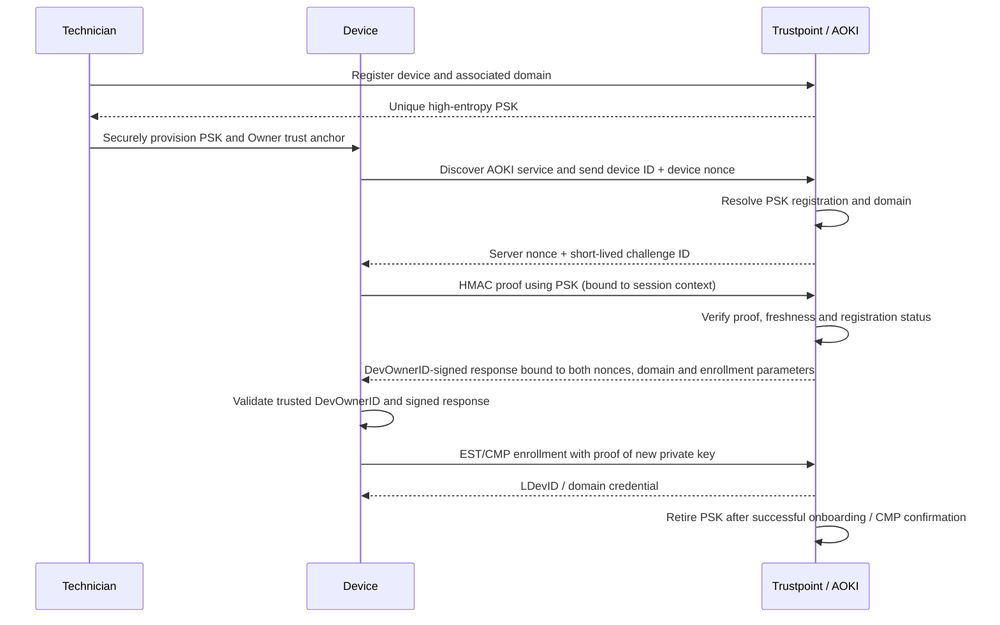

# Trustpoint AOKI Shared-Secret Onboarding — Concept

## 1. Objective

Extend Automated Onboarding Key Infrastructure (AOKI) to support industrial devices without an IEEE 802.1AR IDevID. Such devices authenticate through a **device-specific pre-shared secret (PSK)** and a challenge-response exchange. Keep the existing **DevOwnerID** concept for authenticating and authorizing the owner. This enables automated onboarding **after manual provisioning** of the PSK; it is not fully zero-touch commissioning.

## 2. Core decisions

- **Alternative AOKI authentication:** Keep IDevID-based AOKI; add PSK-based authentication as an optional profile.
- **Explicit feature switch:** Administrators can enable or disable AOKI-PSK globally. It is **disabled by default**; changing this setting does not affect IDevID-based AOKI or standard CMP Shared Secret onboarding.
- **Manual provisioning:** Trustpoint generates a cryptographically random, unique PSK per device. A technician securely transfers it to the device before onboarding.
- **Owner authentication:** Retain DevOwnerID. The device must already trust the relevant DevOwnerID issuing authority or key, provisioned independently of the onboarding response. A PSK by itself does not establish owner authorization.
- **Domain / issuing CA:** An explicit PSK registration maps the device to exactly one Trustpoint domain. Its configured issuing CA and domain credential profile determine issuance. Ambiguous mappings fail closed.
- **Enrollment:** Following successful mutual authentication, use supported enrollment mechanisms (preferably EST or CMP) to issue the LDevID/domain credential; bind enrollment authorization to the authenticated session and requested public key.
- **Single use by default:** Retire the PSK when onboarding is successfully completed, following Trustpoint's existing bootstrap-secret lifecycle. With CMP explicit certificate confirmation, retire only after accepted `certConf`. Renewal uses the issued certificate rather than the PSK.

## 3. Enable / disable AOKI-PSK

Provide an administrator-controlled global setting such as `aoki_psk_enabled` in Trustpoint's existing security configuration (and, if needed, an environment-based deployment override). **Default: `false`**.

- **Enabled:** Allow administrators to create PSK registrations and devices to initiate AOKI-PSK challenges, subject to registration status and all security checks.
- **Disabled:** Reject new AOKI-PSK challenge requests, proof responses and PSK-derived enrollment authorizations (fail closed); do not allow new PSK registrations through UI/API. Existing registrations remain stored for audit/re-enablement but are not usable.
- **Runtime enforcement:** Check the switch at each sensitive step, not only when displaying UI controls; disabling the feature also invalidates or rejects pending AOKI-PSK sessions/tokens.
- **Separation:** The switch must not disable existing IDevID-based AOKI or regular CMP Shared Secret onboarding.
- **Visibility and audit:** Display current state in security settings/capabilities and audit enable/disable actions. Only appropriately privileged administrators can change it.

## 4. Proposed flow

## 5. Implementation approach

| Area | MVP change |
| --- | --- |
| Security configuration | Add `aoki_psk_enabled` (default `false`) with admin UI/API, access control, capability reporting and audit logging. Enforce server-side at challenge, proof and enrollment stages. |
| Onboarding configuration | Add an AOKI PSK authentication option while preserving existing IDevID-based AOKI. |
| PSK registration | Store device identifier, encrypted secret or secret reference, domain, enabled/consumed state, expiration and audit metadata. |
| AOKI endpoint | Implement challenge generation and HMAC verification with nonce expiry, replay prevention and rate limiting. |
| DevOwnerID | Reuse existing credential resolution; require device-side trust-anchor validation and authorization for the intended device/domain. |
| Credential retirement | Reuse Trustpoint's existing onboarding retirement semantics and extend them to the AOKI PSK credential. |

